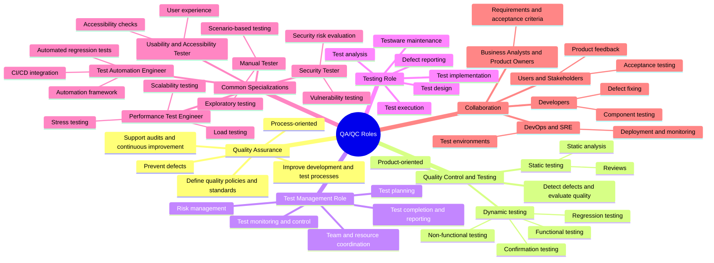

# ISTQB QA/QC Role Mindmap

> Note: ISTQB describes a **test management role** and a **testing role** rather than requiring one fixed job title for each activity. An organization may assign several roles to one person or divide one role among several people.

## Find 3 Errors

### 1. Trình bày QA như một vai trò riêng

- **Trong mindmap:** “Quality Assurance” được đặt ngang hàng với các nhánh vai trò.
- **Evidence ISTQB:** QA là “responsibility of everyone on a project” — trách nhiệm của mọi người trong dự án. **Mục 1.2.2, trang in 17 (PDF trang 16), L507–L510.**
- **Vì sao cần sửa:** Sơ đồ dễ khiến người đọc nghĩ QA luôn là một chức danh hoặc vai trò độc lập. Nên ghi QA là *approach/responsibility*. Ghi chú cuối mindmap về hai principal roles — *test management role* và *testing role* — phù hợp với ISTQB ở **mục 1.4.5, trang in 21 (PDF trang 20), L672–L684**.
- **Nguồn:** [ISTQB Certified Tester Foundation Level Syllabus v4.0.1](https://istqb.org/wp-content/uploads/2024/11/ISTQB_CTFL_Syllabus_v4.0.1.pdf)

### 2. Gộp Quality Control với Testing

- **Trong mindmap:** Tiêu đề nhánh là “Quality Control and Testing”, có thể làm hai khái niệm trông như đồng nghĩa.
- **Evidence ISTQB:** Testing là “a major form of quality control” — một hình thức chính của QC; syllabus cũng nêu các hình thức QC khác. **Mục 1.2.2, trang in 17 (PDF trang 16), L504–L506.**
- **Vì sao cần sửa:** Testing là một phần của QC, không bao trùm toàn bộ QC. Có thể đổi nhãn thành **“Quality Control (includes testing)”**. Đây là điểm trình bày khái niệm, nên nhận xét là *dễ gây hiểu nhầm* chính xác hơn việc khẳng định toàn bộ nhánh sai.
- **Nguồn:** [ISTQB Certified Tester Foundation Level Syllabus v4.0.1](https://istqb.org/wp-content/uploads/2024/11/ISTQB_CTFL_Syllabus_v4.0.1.pdf)

### 3. Xếp confirmation/regression dưới Dynamic Testing

- **Trong mindmap:** Confirmation testing và regression testing nằm bên dưới Dynamic testing, cùng cấp với Functional và Non-functional testing.
- **Evidence ISTQB:** Syllabus trình bày **Test Types** ở mục 2.2.2, rồi có mục riêng **“Confirmation Testing and Regression Testing”** ở mục 2.2.3. **Trang in 30–31 (PDF trang 29–30), L950–L1009.**
- **Vì sao cần sửa:** Cách xếp nhánh này trộn hai kiểu phân loại: các test type với testing sau khi thay đổi hoặc sửa lỗi. Nên tách confirmation và regression thành nhánh **“Testing after changes”**. Đây là điểm phân loại gây hiểu nhầm; không có nghĩa hai loại test này không thể được thực hiện bằng cách chạy test.
- **Nguồn:** [ISTQB Certified Tester Foundation Level Syllabus v4.0.1](https://istqb.org/wp-content/uploads/2024/11/ISTQB_CTFL_Syllabus_v4.0.1.pdf)
