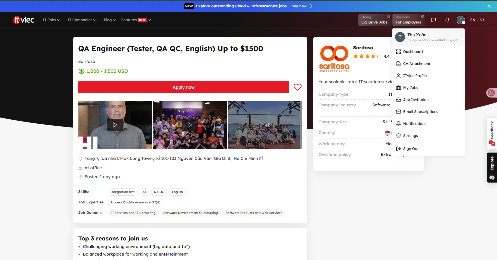
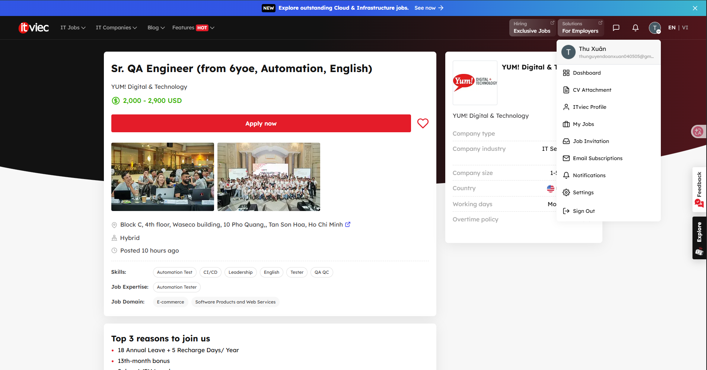
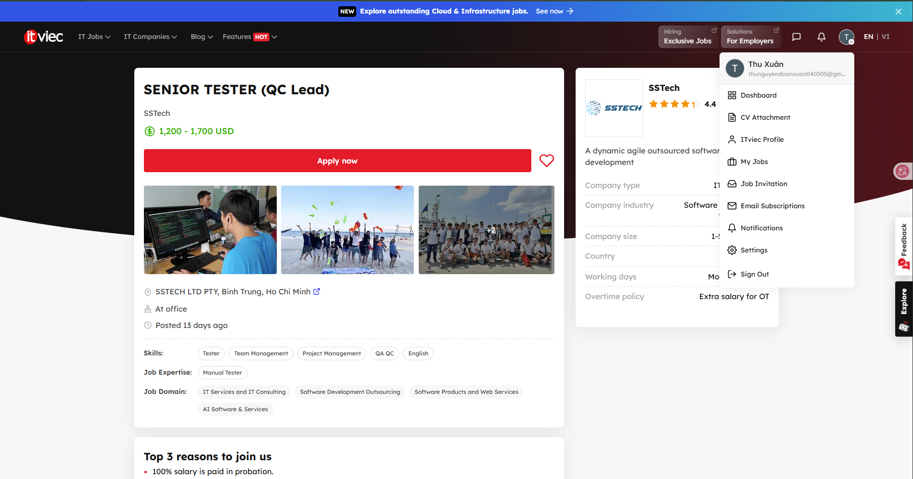
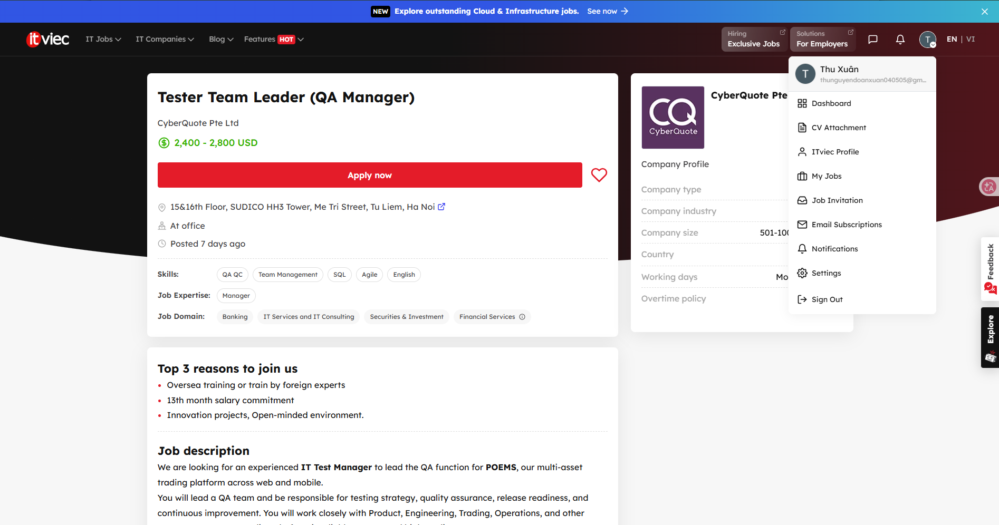
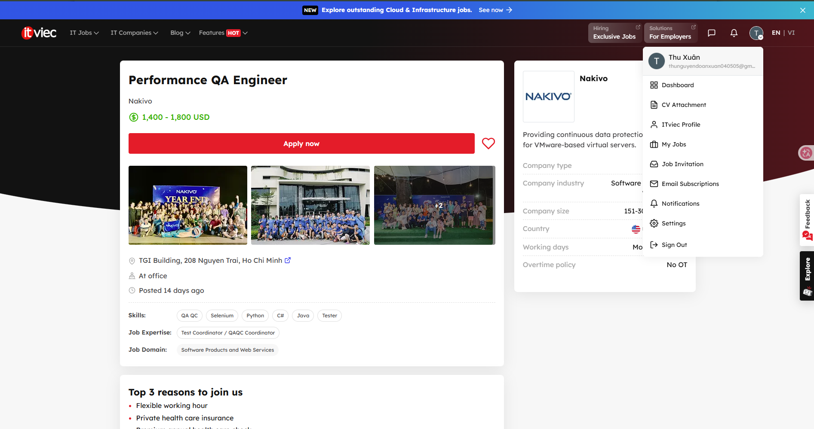
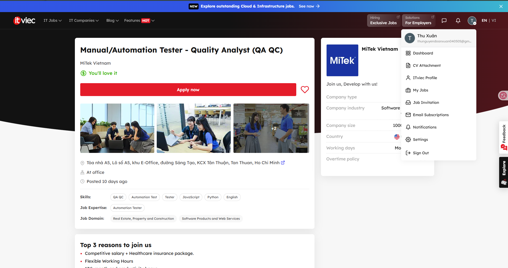
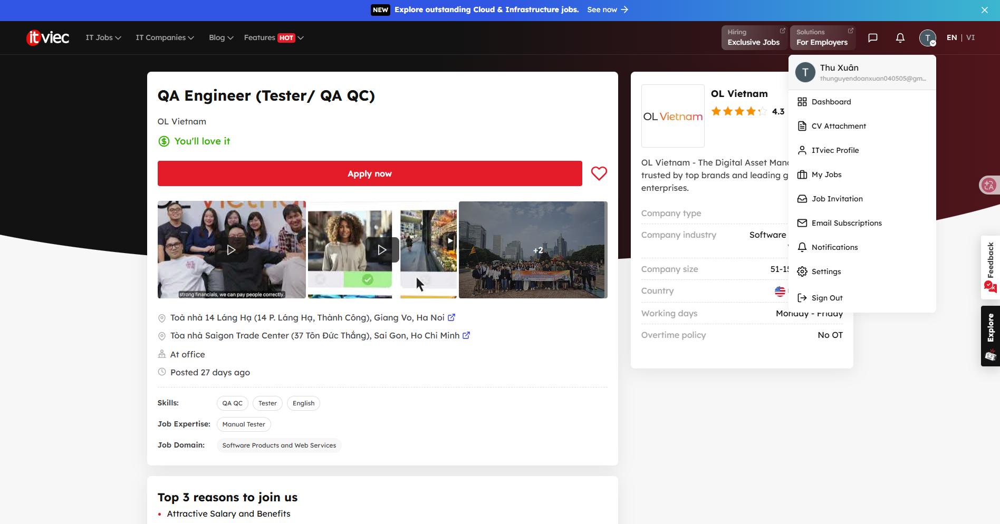
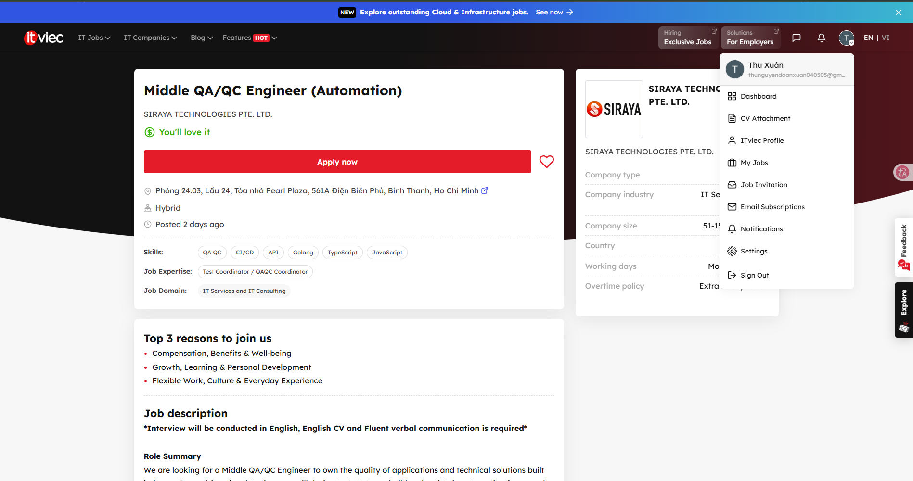
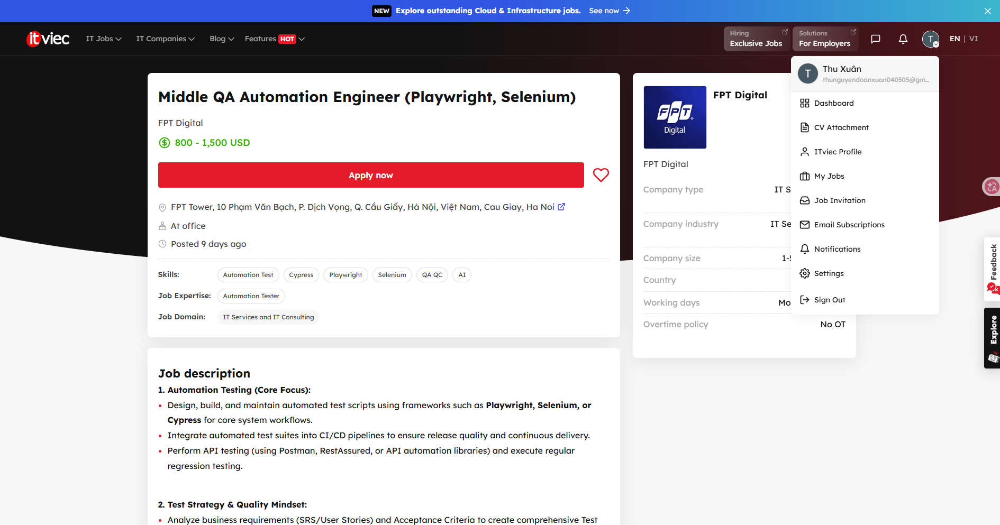
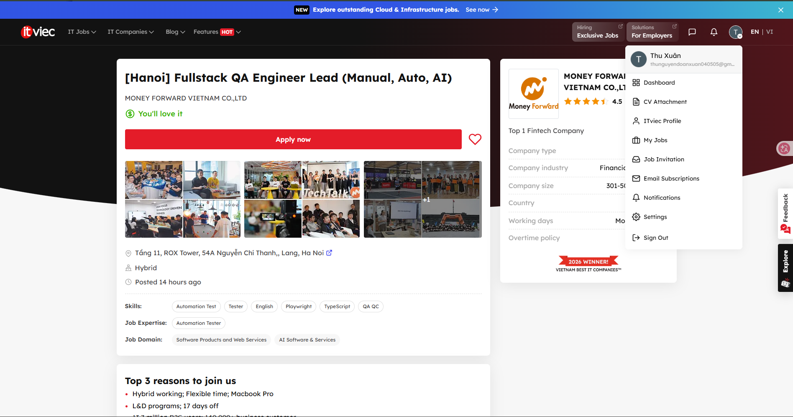

# Báo cáo HW01

## Requirement 1 – Thị trường việc làm QA/QC 2026+

### 1.1 Tổng hợp các tin tuyển dụng đã thu thập

| STT | Vị trí và công ty | Hình thức làm việc/địa điểm | Thời gian đăng hiển thị ngày 25/09/2026 | Mức lương hiển thị | Liên quan đến AI |
|---:|---|---|---|---|---|
| 1 | QA Engineer (Tester, QA QC, English) – Saritasa | Tại văn phòng, TP. Hồ Chí Minh | 1 ngày trước | USD 1,000–1,500 | Ưu tiên; không tính vào ba vị trí bắt buộc |
| 2 | Sr. QA Engineer (from 6yoe, Automation, English) – YUM! Digital & Technology | Hybrid, TP. Hồ Chí Minh | 10 giờ trước | USD 2,000–2,900 | Không yêu cầu AI rõ ràng |
| 3 | Senior Tester (QC Lead) – SSTech | Tại văn phòng, TP. Hồ Chí Minh | 13 ngày trước | USD 1,200–1,700 | Không yêu cầu AI rõ ràng |
| 4 | Tester Team Leader (QA Manager) – CyberQuote Pte Ltd | Tại văn phòng, Hà Nội | 7 ngày trước | USD 2,400–2,800 | Không yêu cầu AI rõ ràng |
| 5 | Performance QA Engineer – Nakivo | Tại văn phòng, TP. Hồ Chí Minh | 14 ngày trước | USD 1,400–1,800 | Có — bắt buộc |
| 6 | Manual/Automation Tester – Quality Analyst (QA QC) – MiTek Vietnam | Tại văn phòng, TP. Hồ Chí Minh | 10 ngày trước | “You'll love it”; không hiển thị mức lương cụ thể | Không yêu cầu AI rõ ràng |
| 7 | QA Engineer (Tester/QA QC) – OL Vietnam | Tại văn phòng, Hà Nội hoặc TP. Hồ Chí Minh | 27 ngày trước | “You'll love it”; không hiển thị mức lương cụ thể | Không yêu cầu AI rõ ràng |
| 8 | Middle QA/QC Engineer (Automation) – SIRAYA TECHNOLOGIES PTE. LTD. | Hybrid, TP. Hồ Chí Minh | 2 ngày trước | “You'll love it”; không hiển thị mức lương cụ thể | Không yêu cầu AI rõ ràng |
| 9 | Middle QA Automation Engineer (Playwright, Selenium) – FPT Digital | Tại văn phòng, Hà Nội | 9 ngày trước | USD 800–1,500 | Có — bắt buộc |
| 10 | Fullstack QA Engineer Lead (Manual, Auto, AI) – Money Forward Vietnam | Hybrid, Hà Nội | 14 giờ trước | “You'll love it”; không hiển thị mức lương cụ thể | Có — bắt buộc |

> **Ghi chú về thời gian đăng:** Bảng giữ nguyên thời gian đăng tương đối do ITviec hiển thị tại ngày truy cập. Các ảnh chụp có ngày là bằng chứng chính để chứng minh yêu cầu tin tuyển dụng được đăng trong vòng 60 ngày.

### 1.2 Đánh giá chi tiết từng tin tuyển dụng

#### Job 1 – QA Engineer (Tester, QA QC, English), Saritasa

- **Link:** [Tin tuyển dụng trên ITviec](https://itviec.com/it-jobs/qa-engineer-tester-qa-qc-english-up-to-1500-saritasa-4856?lab_feature=preview_jd_page)
- **Bằng chứng ảnh chụp (ngày 25/09/2026):**

  
- **Mô tả công việc:** Vị trí tập trung vào việc hiểu đặc tả, áp dụng các nguyên tắc kiểm thử phần mềm, phân tách yêu cầu phức tạp thành các use case có thể kiểm thử và ghi nhận defect bằng ảnh chụp hoặc video. Công việc bao gồm kiểm thử web, mobile, API và integration trong một nhóm có hoạt động review và kiểm thử chéo.
- **Kỹ năng yêu cầu/ưu tiên:** Ít nhất ba năm kinh nghiệm manual QA/testing, ưu tiên có kinh nghiệm automation testing; nắm lý thuyết và kỹ thuật kiểm thử; phân tích yêu cầu; chú ý chi tiết; tư duy logic và phân tích; sử dụng JMeter, Postman, Git và ưu tiên biết Linux; kiểm thử web, mobile và API; tiếng Anh và giao tiếp tốt. Tin tuyển dụng cũng ưu tiên ứng viên thoải mái sử dụng công cụ AI để tăng tốc thiết kế test và công việc hằng ngày.
- **Mức lương:** USD 1,000–1,500.
- **Phân tích tác động của AI:** Theo mô tả tuyển dụng, AI có thể hỗ trợ phác thảo ý tưởng kiểm thử và đẩy nhanh việc lập tài liệu thường xuyên. QA Engineer vẫn phải hiểu yêu cầu riêng của dự án, đánh giá giá trị của các test được đề xuất, thực hiện kiểm tra phù hợp và cung cấp bằng chứng defect đáng tin cậy.

#### Job 2 – Sr. QA Engineer (from 6yoe, Automation, English), YUM! Digital & Technology

- **Link:** [Tin tuyển dụng trên ITviec](https://itviec.com/it-jobs/sr-qa-engineer-from-6yoe-automation-english-yum-digital-technology-5203?lab_feature=preview_jd_page)
- **Bằng chứng ảnh chụp (ngày 25/09/2026):**

  
- **Mô tả công việc:** Senior Quality Engineer xác định và triển khai chiến lược kiểm thử cho nền tảng thương mại Byte by Yum!. Trách nhiệm gồm functional, integration, end-to-end và performance testing; xây dựng automation framework cho web và mobile; manual và exploratory testing; phối hợp CI/CD; lập kế hoạch và báo cáo kiểm thử; cải tiến quy trình và quản lý defect.
- **Kỹ năng yêu cầu:** Bằng cử nhân liên quan; ít nhất sáu năm làm software QA, bao gồm kinh nghiệm ở cấp senior; kinh nghiệm với nền tảng thương mại điện tử quy mô lớn hoặc nền tảng người dùng lưu lượng cao; khả năng dẫn dắt chiến lược kiểm thử; sử dụng automation framework như Maestro, Playwright, Cypress, Selenium hoặc Appium; phối hợp đa chức năng; giải quyết vấn đề; tiếng Anh tốt và khả năng thích nghi.
- **Mức lương:** USD 2,000–2,900.
- **Phân tích tác động của AI:** AI có thể hỗ trợ tạo test đề xuất, tóm tắt kết quả và viết automation code, nhưng tin tuyển dụng không yêu cầu rõ kỹ năng AI. Phán đoán của con người vẫn cần thiết cho chiến lược, exploratory testing, ưu tiên defect và đánh giá độ tin cậy trước khi release trên toàn nền tảng và từng thương hiệu.

#### Job 3 – Senior Tester (QC Lead), SSTech

- **Link:** [Tin tuyển dụng trên ITviec](https://itviec.com/it-jobs/senior-tester-qc-lead-sstech-3634?lab_feature=preview_jd_page)
- **Bằng chứng ảnh chụp (ngày 25/09/2026):**

  
- **Mô tả công việc:** Đây là vị trí kiểm soát chất lượng chính và được kỳ vọng sẽ đảm nhận vai trò dẫn dắt test team. Công việc gồm làm rõ yêu cầu, phát hiện logic mơ hồ hoặc còn thiếu và các edge case, xây dựng test plan và scenario từ acceptance criteria, viết defect report có thể tái hiện, xác minh bản sửa lỗi và quản lý rủi ro tiến độ/chất lượng giữa các dự án.
- **Kỹ năng yêu cầu:** Kinh nghiệm software QA/QC, trong đó có ít nhất một năm làm Test Lead hoặc Senior QA chịu trách nhiệm về đầu ra dự án; tiếng Anh tốt; phân tích yêu cầu; thiết kế test tập trung vào edge case; khả năng ưu tiên kiểm thử khi thời hạn release gấp.
- **Mức lương:** USD 1,200–1,700.
- **Phân tích tác động của AI:** AI có thể đề xuất test scenario hoặc cải thiện cấu trúc defect report, nhưng không thể tự giải quyết business rule mơ hồ hoặc chịu trách nhiệm về rủi ro release. Những công việc này cần trao đổi với project team và phán đoán có trách nhiệm của con người.

#### Job 4 – Tester Team Leader (QA Manager), CyberQuote Pte Ltd

- **Link:** [Tin tuyển dụng trên ITviec](https://itviec.com/it-jobs/tester-team-leader-qa-manager-cyberquote-pte-ltd-0617?lab_feature=preview_jd_page)
- **Bằng chứng ảnh chụp (ngày 25/09/2026):**

  
- **Mô tả công việc:** Test Manager dẫn dắt QA cho nền tảng giao dịch đa tài sản POEMS trên web và mobile. Vị trí chịu trách nhiệm về chiến lược và tiêu chuẩn QA, phát triển đội ngũ, lập kế hoạch kiểm thử nhiều dự án, chất lượng workflow giao dịch, định hướng automation, khuyến nghị release, metric, giao tiếp với stakeholder, cùng các vấn đề bảo mật, tuân thủ và quyền riêng tư dữ liệu.
- **Kỹ năng yêu cầu:** Tám đến mười năm kinh nghiệm software QA/testing; dẫn dắt đội QA; lập kế hoạch và thực thi kiểm thử; quản lý defect, regression và release; kinh nghiệm với nền tảng giao dịch hoặc thị trường vốn; hiểu workflow giao dịch; năng lực kỹ thuật về automation, API, database, performance và security testing. Trang tuyển dụng cũng liệt kê QA/QC, quản lý nhóm, SQL, Agile và tiếng Anh.
- **Mức lương:** USD 2,400–2,800.
- **Phân tích tác động của AI:** AI có thể hỗ trợ báo cáo, xem xét dữ liệu rủi ro và đề xuất automation, nhưng tin tuyển dụng không liệt kê AI là yêu cầu. Các quyết định về mức độ sẵn sàng release, tuân thủ, rủi ro kinh doanh, quản lý nhân sự và giao tiếp với stakeholder vẫn thuộc trách nhiệm của manager.

#### Job 5 – Performance QA Engineer, Nakivo **(liên quan đến AI)**

- **Link:** [Tin tuyển dụng trên ITviec](https://itviec.com/it-jobs/performance-qa-engineer-nakivo-2956?lab_feature=preview_jd_page)
- **Bằng chứng ảnh chụp (ngày 25/09/2026):**

  
- **Mô tả công việc:** Engineer phối hợp với developer và nhân viên QA, tạo và thực thi automated test, báo cáo defect, phân tích kết quả, xử lý sự cố và cải thiện phương pháp automation. Tin tuyển dụng nêu cụ thể việc thiết kế, tạo và quản lý automation test case bằng công nghệ AI.
- **Kỹ năng yêu cầu:** Bằng cử nhân liên quan; hiểu software development life cycle và phương pháp kiểm thử; ít nhất bốn năm kinh nghiệm liên quan; Java, Python hoặc C#; Selenium, Appium hoặc công cụ tương tự; Git; kỹ năng phân tích, giao tiếp và hợp tác. Vị trí yêu cầu rõ kinh nghiệm AI-automation testing với các công cụ như Copilot, Cursor hoặc Perplexity, đồng thời xem kinh nghiệm thực hành AI là một tiêu chí mong muốn.
- **Mức lương:** USD 1,400–1,800.
- **Phân tích tác động của AI:** AI là công cụ làm việc trực tiếp để tạo test case và automation trong vị trí này. AI có thể tăng tốc việc tạo script và phân tích, nhưng engineer vẫn phải xác minh các test được sinh ra, chẩn đoán lỗi, trao đổi về defect và đánh giá coverage có ý nghĩa kỹ thuật hay không.

#### Job 6 – Manual/Automation Tester – Quality Analyst (QA QC), MiTek Vietnam

- **Link:** [Tin tuyển dụng trên ITviec](https://itviec.com/it-jobs/manual-automation-tester-selenium-qa-qc-mitek-vietnam-0430?lab_feature=preview_jd_page)
- **Bằng chứng ảnh chụp (ngày 25/09/2026):**

  
- **Mô tả công việc:** Tester thiết kế, duy trì và thực thi functional, regression và automated test cho nền tảng Kova của MiTek. Vị trí cũng phát triển automation cho web, ứng dụng Windows và API; ghi nhận và theo dõi defect; xử lý lỗi script; refactor các test hiện có; phối hợp với các nhóm tại Việt Nam và Hoa Kỳ để làm rõ yêu cầu và thiết kế.
- **Kỹ năng yêu cầu:** Ít nhất ba năm kinh nghiệm software testing/QA, gồm cả manual và automation; automation cho web, ứng dụng Windows và API; phương pháp Agile; quy trình và kỹ thuật kiểm thử; giải quyết vấn đề, giao tiếp, hợp tác và tiếng Anh. SQL, Postman, CI/CD và Python là các kỹ năng được ưu tiên.
- **Mức lương:** Không hiển thị mức cụ thể; ảnh chụp hiển thị “You'll love it.”
- **Phân tích tác động của AI:** AI có thể hỗ trợ phác thảo automation code hoặc đề xuất regression scenario, nhưng tin tuyển dụng không yêu cầu rõ kỹ năng AI. Tester vẫn phải làm rõ hành vi sản phẩm, debug automation, xác minh defect và đánh giá các test có cung cấp đủ coverage hay không.

#### Job 7 – QA Engineer (Tester/QA QC), OL Vietnam

- **Link:** [Tin tuyển dụng trên ITviec](https://itviec.com/it-jobs/qa-engineer-tester-qa-qc-ol-vietnam-3927?lab_feature=preview_jd_page)
- **Bằng chứng ảnh chụp (ngày 25/09/2026):**

  
- **Mô tả công việc:** QA Engineer thiết kế và thực thi chiến lược manual testing nhằm tìm và ghi nhận defect trước khi release, ngăn regression, đánh giá tính năng mới từ góc nhìn người dùng, đồng thời đề xuất cải tiến cho cả sản phẩm và phương pháp kiểm thử.
- **Kỹ năng yêu cầu:** Có nhiều kinh nghiệm manual testing ứng dụng phức tạp; tiếng Anh viết và nói; hiểu software development; có tính kỷ luật và tư duy hợp lý khi lịch trình gấp. Kinh nghiệm accessibility testing và kiến thức automation với Cypress hoặc Selenium cùng các ngôn ngữ như TypeScript, Java, JavaScript hoặc C# được ưu tiên nhưng không bắt buộc.
- **Mức lương:** Không hiển thị mức cụ thể; “You'll love it.”
- **Phân tích tác động của AI:** AI có thể hỗ trợ brainstorm user scenario hoặc tóm tắt kết quả regression, nhưng tin tuyển dụng không yêu cầu rõ kỹ năng AI. Việc đánh giá sản phẩm từ góc nhìn người dùng cuối và xác định điểm “hoạt động chưa tốt” cần ngữ cảnh, sự đồng cảm và review của con người.

#### Job 8 – Middle QA/QC Engineer (Automation), SIRAYA TECHNOLOGIES PTE. LTD.

- **Link:** [Tin tuyển dụng trên ITviec](https://itviec.com/it-jobs/middle-qa-qc-engineer-automation-siraya-technologies-pte-ltd-2622?lab_feature=preview_jd_page)
- **Bằng chứng ảnh chụp (ngày 25/09/2026):**

  
- **Mô tả công việc:** Engineer chịu trách nhiệm về chất lượng ứng dụng bằng cách thiết kế test strategy và test case; thực hiện functional, integration, API, regression, end-to-end và performance/load testing cơ bản; xây dựng API và web automation. Vị trí tích hợp test với CI/CD, đọc application code để chẩn đoán defect, xác minh bản sửa, theo dõi quality metric và đóng góp vào tiêu chuẩn cùng tài liệu QA.
- **Kỹ năng yêu cầu:** Ít nhất một năm kinh nghiệm QA/QC và ít nhất hai năm làm developer; có khả năng đọc code và viết test script; JavaScript/TypeScript hoặc Golang; API testing với Postman/REST; Playwright và/hoặc Cypress; kiến thức system architecture và HTTP/API; kinh nghiệm CI/CD; kỹ năng phân tích, debugging, giao tiếp và tiếng Anh lưu loát.
- **Mức lương:** Không hiển thị mức cụ thể; “You'll love it.”
- **Phân tích tác động của AI:** AI có thể hỗ trợ tạo bản nháp test script hoặc điều tra log, nhưng tin tuyển dụng không nêu yêu cầu AI. Engineer vẫn chịu trách nhiệm về kiểm thử có xét đến kiến trúc, chẩn đoán ở cấp code, bảo trì framework và xác minh bản sửa.

#### Job 9 – Middle QA Automation Engineer (Playwright, Selenium), FPT Digital **(liên quan đến AI)**

- **Link:** [Tin tuyển dụng trên ITviec](https://itviec.com/it-jobs/middle-qa-automation-engineer-playwright-selenium-fpt-digital-4422?lab_feature=preview_jd_page)
- **Bằng chứng ảnh chụp (ngày 25/09/2026):**

  
- **Mô tả công việc:** Vị trí xây dựng UI và API automation, tích hợp test với CI/CD, thực hiện regression và data validation, đồng thời quản lý defect. Công việc còn kiểm thử các tính năng AI/LLM như chatbot, trích xuất dữ liệu tự động và workflow retrieval-augmented generation; đánh giá độ chính xác, đầy đủ, source attribution và hallucination; so sánh output giữa các biến thể prompt.
- **Kỹ năng yêu cầu:** Bằng cử nhân liên quan; hai đến bốn năm kinh nghiệm manual và automation testing; Playwright, Selenium hoặc Cypress với JavaScript/TypeScript, Python hoặc Java; API testing; SQL và kỹ năng phân tích QA. Yêu cầu AI là đã có kinh nghiệm kiểm thử tính năng AI/LLM **hoặc** thường xuyên sử dụng công cụ như ChatGPT hay Claude trong công việc QA hằng ngày, đồng thời sẵn sàng chuyên môn hóa về AI quality assurance.
- **Mức lương:** USD 800–1,500.
- **Phân tích tác động của AI:** AI vừa tạo ra đối tượng cần kiểm thử, vừa hỗ trợ công việc kiểm thử trong vị trí này. AI có thể tăng tốc việc tạo test data, test case và script, trong khi QA Engineer phải đánh giá output không xác định, hallucination, bằng chứng nguồn, tính ổn định và nhất quán thay vì chấp nhận kết quả được tạo ra ngay lập tức.

#### Job 10 – Fullstack QA Engineer Lead (Manual, Auto, AI), Money Forward Vietnam **(liên quan đến AI)**

- **Link:** [Tin tuyển dụng trên ITviec](https://itviec.com/it-jobs/hanoi-fullstack-qa-engineer-lead-manual-auto-ai-money-forward-vietnam-co-ltd-4636?lab_feature=preview_jd_page)
- **Bằng chứng ảnh chụp (ngày 25/09/2026):**

  
- **Mô tả công việc:** Vị trí leadership này kết hợp manual testing, end-to-end/API automation, performance, nhận thức về security, quản trị rủi ro release, kiến trúc automation, code review, hỗ trợ đội ngũ outsource và shift-left testing. Nhiệm vụ liên quan đến AI gồm dẫn dắt việc áp dụng generative AI cho test design, tạo script và triage; xác minh các tính năng sản phẩm có AI hỗ trợ; xây dựng hướng dẫn sử dụng AI an toàn và tuân thủ quyền riêng tư.
- **Kỹ năng yêu cầu:** Bằng cử nhân liên quan; ít nhất tám năm kinh nghiệm QA/SDET, trong đó có từ ba năm technical leadership; tiếng Anh lưu loát; automation TypeScript/JavaScript hoặc Python nâng cao với Playwright, Cypress hay Selenium; REST/GraphQL API testing; SQL; CI/CD và Docker; năng lực lãnh đạo chiến lược chất lượng; chủ động sử dụng công cụ generative AI hằng ngày để cải thiện hoạt động QA.
- **Mức lương:** Không hiển thị mức cụ thể; “You'll love it.”
- **Phân tích tác động của AI:** AI được sử dụng rõ ràng để tăng tốc thiết kế, viết script và triage, trong khi lead quản lý cách nhóm sử dụng AI an toàn. Trách nhiệm của con người vẫn thiết yếu trong quyết định release dựa trên rủi ro, quy tắc quyền riêng tư, code review, mentoring và xác minh các tính năng có AI hỗ trợ.

---

# Requirement 2 – 20 software defects được công bố trong giai đoạn 2022–2026

## 2.1 Phương pháp trình bày và kiểm tra

Danh sách gồm 20 defects, trong đó bảy mục đầu liên quan đến AI/LLM. Trường **“AI giải thích (nguyên văn)”** được sao chép nguyên văn từ phần AI output trong `HW01/prompt_log.md`, dòng 90–112. Các trường còn lại được viết sau khi đối chiếu nguồn. Severity không có thang điểm chính thức trong nguồn được ghi rõ là **đánh giá của báo cáo**.

Trường **“Instance bias/hallucination của AI”** ghi kết quả review thực tế. Nếu lời giải thích khớp nguồn, báo cáo ghi “không phát hiện” thay vì tạo ra một lỗi không có thật; omission, diễn đạt quá mức hoặc suy luận không được nguồn xác nhận được nêu rõ và không tự động bị gọi là hallucination.

## 2.2 Các defect liên quan đến AI/LLM

### 1. ChatGPT – cross-user chat history and payment data exposure (2023)

- **AI giải thích (nguyên văn):** **ChatGPT — cross-user chat history & payment data exposure (2023):** Một lỗi khiến một số người dùng có thể nhìn thấy **tiêu đề/lịch sử chat của người khác**; trong một khoảng thời gian, một số thông tin liên quan đến thanh toán cũng có thể bị lộ. → **Lỗi: rò rỉ dữ liệu giữa người dùng.**
- **Nguồn:** [OpenAI – March 20 ChatGPT outage](https://openai.com/index/march-20-chatgpt-outage/)
- **Mô tả:** Một lỗi trong thư viện `redis-py` có thể khiến dữ liệu cache của một yêu cầu được trả về cho người dùng khác trong một điều kiện thời gian hiếm gặp. OpenAI xác nhận một số người dùng có thể thấy tiêu đề chat của người khác; tin nhắn đầu tiên của một cuộc trò chuyện mới cũng có thể bị lộ trong một số trường hợp. Trong một khoảng thời gian chín giờ, thông tin thanh toán giới hạn của 1,2% người dùng ChatGPT Plus đang hoạt động cũng có thể bị ảnh hưởng; toàn bộ số thẻ không bị lộ.
- **Severity:** **High (đánh giá của báo cáo)** vì lỗi vượt qua ranh giới dữ liệu giữa người dùng và có thể làm lộ dữ liệu trò chuyện cùng metadata thanh toán, dù phạm vi được báo cáo có giới hạn.
- **Hậu quả:** Xâm phạm quyền riêng tư, có thể lộ tiêu đề chat, tin nhắn đầu tiên của chat mới và một số thông tin nhận dạng/thanh toán; đồng thời gây gián đoạn dịch vụ và giảm lòng tin.
- **Giải pháp:** OpenAI đưa ChatGPT tạm thời offline, vá lỗi thư viện, bổ sung kiểm tra để xác nhận dữ liệu thuộc đúng người yêu cầu, rà soát log, cải thiện giám sát và tăng độ ổn định của Redis cluster.
- **Instance bias/hallucination của AI:** Cụm **“tiêu đề/lịch sử chat của người khác”** có thể khiến người đọc hiểu rằng toàn bộ nội dung lịch sử chat bị lộ. Nguồn chỉ xác nhận tiêu đề chat và, trong một số trường hợp, tin nhắn đầu tiên của cuộc trò chuyện mới. Đây là diễn đạt quá rộng về phạm vi dữ liệu.

### 2. Bing Chat – indirect prompt injection and data leakage (2023)

- **AI giải thích (nguyên văn):** **Bing Chat — indirect prompt injection & data leakage (2023):** Nội dung trên một website có thể chứa chỉ dẫn độc hại, khiến AI đọc nó và **bị dẫn dắt làm những việc ngoài ý muốn**, chẳng hạn tiết lộ thông tin trong ngữ cảnh. → **Lỗi: AI tin dữ liệu không đáng tin.**
- **Nguồn:** [Microsoft – Prompt injection attack technique](https://learn.microsoft.com/nl-nl/security/zero-trust/catalog-ai-attack-techniques/prompt-injection)
- **Mô tả:** Chỉ dẫn độc hại được ẩn trên một website đã khiến Bing Chat xử lý nội dung của trang như lệnh. Hệ thống tạo yêu cầu đến máy chủ do attacker kiểm soát và làm lộ dữ liệu hội thoại qua URL parameters.
- **Severity:** **High (đánh giá của báo cáo)** vì nội dung web không đáng tin có thể điều khiển assistant vượt qua ranh giới tin cậy và làm lộ dữ liệu hội thoại.
- **Hậu quả:** Người dùng có thể vô tình làm lộ dữ liệu hội thoại khi yêu cầu AI đọc một trang độc hại; những hệ thống có tool access còn có nguy cơ thực hiện hành động ngoài ý muốn.
- **Giải pháp:** Microsoft đã sửa trường hợp cụ thể này. Các biện pháp phòng ngừa gồm mô hình mạnh hơn, least privilege, RBAC cho tool và dữ liệu, cô lập dữ liệu nhạy cảm, lọc prompt, và quét hoặc làm sạch nội dung bên ngoài.
- **Instance bias/hallucination của AI:** Không phát hiện thông tin sai. Cụm **“tiết lộ thông tin trong ngữ cảnh”** đúng nhưng quá chung và bỏ sót cơ chế cụ thể: yêu cầu đến máy chủ attacker đã mang dữ liệu hội thoại trong URL parameters. Đây là omission, không phải hallucination.

### 3. Air Canada chatbot – bereavement-fare misinformation (2024)

- **AI giải thích (nguyên văn):** **Air Canada chatbot — bereavement-fare misinformation (2024):** Chatbot cung cấp **thông tin sai về chính sách vé tang lễ**, khiến khách hàng dựa vào lời chatbot rồi gặp vấn đề khi yêu cầu hoàn tiền. → **Lỗi: AI đưa thông tin dịch vụ sai.**
- **Nguồn:** [Law360 Canada – quyết định về thông tin sai từ chatbot Air Canada](https://www.law360.ca/ca/articles/1804075/court-rejects-air-canada-s-remarkable-denial-of-liability-regarding-misinformation-by-its-chatbot)
- **Mô tả:** Chatbot nói khách hàng có thể xin áp dụng bereavement fare sau chuyến đi trong vòng 90 ngày, trái với chính sách thực tế của Air Canada. Khách hàng đã dựa vào câu trả lời này khi mua vé.
- **Severity:** **Medium (đánh giá của báo cáo)** vì câu trả lời sai gây thiệt hại tài chính và trách nhiệm pháp lý nhưng không làm lộ dữ liệu hoặc chiếm quyền hệ thống.
- **Hậu quả:** Khách hàng trả nhiều hơn dự kiến, phải yêu cầu giải quyết tranh chấp; Air Canada phải bồi thường và chịu tổn hại uy tín.
- **Giải pháp:** Đồng bộ câu trả lời chatbot với nguồn chính sách chính thức, regression-test các chính sách quan trọng, dẫn nguồn điều khoản, giám sát output và chuyển sang nhân viên khi không thể xác định câu trả lời đáng tin cậy.
- **Instance bias/hallucination của AI:** Không phát hiện bias hoặc hallucination trong lời giải thích; nội dung khớp nguồn về chính sách sai và việc khách hàng dựa vào thông tin đó.

### 4. DPD customer-service chatbot – offensive responses (2024)

- **AI giải thích (nguyên văn):** **DPD customer-service chatbot — offensive responses (2024):** Chatbot hỗ trợ khách hàng bị dụ vào một cuộc hội thoại và tạo ra **câu trả lời xúc phạm/chê chính công ty**. → **Lỗi: AI tạo nội dung không phù hợp.**
- **Nguồn:** [Sky News – DPD chatbot swears and criticizes the company](https://news.sky.com/story/dpd-customer-service-chatbot-swears-and-calls-company-worst-delivery-firm-13052037)
- **Mô tả:** Sau khi không cung cấp được thông tin bưu kiện hữu ích hoặc kết nối người dùng với nhân viên, chatbot đã làm theo prompt để chửi tục và viết bài thơ chê DPD. DPD cho biết lỗi xuất hiện sau một bản cập nhật hệ thống.
- **Severity:** **Medium (đánh giá của báo cáo)** vì sự cố làm hỏng chức năng hỗ trợ và uy tín nhưng nguồn không báo cáo xâm nhập hệ thống hoặc rò rỉ dữ liệu.
- **Hậu quả:** Người dùng không được hỗ trợ đúng mục đích, chatbot tạo nội dung phản cảm, sự cố lan truyền công khai và thành phần AI phải bị vô hiệu hóa.
- **Giải pháp:** DPD vô hiệu hóa thành phần AI và cập nhật hệ thống. Cần bổ sung regression testing, adversarial-prompt testing, kiểm soát output và đường chuyển tiếp đáng tin cậy đến nhân viên hỗ trợ.
- **Instance bias/hallucination của AI:** Không phát hiện bias hoặc hallucination; lời giải thích khớp việc bot chửi tục và tạo nội dung chê công ty. Chi tiết bản cập nhật hệ thống không được AI nhắc đến nhưng không làm phần giải thích trở thành sai.

### 5. Gemini image generation – inaccurate and biased depictions (2024)

- **AI giải thích (nguyên văn):** **Gemini image generation — inaccurate & biased depictions (2024):** AI tạo hình ảnh với một số yêu cầu lịch sử nhưng **mô tả không chính xác về chủng tộc/giới tính/bối cảnh lịch sử**. → **Lỗi: mô hình tạo nội dung sai lệch/bias.**
- **Nguồn:** [Google – Gemini image-generation issue](https://blog.google/products-and-platforms/products/gemini/gemini-image-generation-issue/)
- **Mô tả:** Gemini đôi khi tạo hình ảnh con người không chính xác hoặc xúc phạm. Việc điều chỉnh để tạo output đa dạng không tính đủ các trường hợp diversity không phù hợp với bối cảnh lịch sử; các safeguard khác cũng khiến hệ thống từ chối nhầm một số prompt vô hại.
- **Severity:** **Medium (đánh giá của báo cáo)** vì lỗi ảnh hưởng độ chính xác, fairness và niềm tin nhưng nguồn không mô tả xâm nhập hệ thống hay dữ liệu.
- **Hậu quả:** Hình ảnh có thể xuyên tạc bối cảnh lịch sử hoặc văn hóa, gây phản cảm, từ chối yêu cầu hợp lệ và làm giảm lòng tin; Google phải tạm dừng tính năng tạo ảnh người.
- **Giải pháp:** Google tạm dừng tính năng bị ảnh hưởng, điều chỉnh lại hệ thống và yêu cầu kiểm thử rộng trước khi mở lại. Evaluation cần đồng thời kiểm tra tính đa dạng và tính đúng đắn theo ngữ cảnh lịch sử.
- **Instance bias/hallucination của AI:** AI nêu riêng **“giới tính”**, trong khi nguồn được dùng nói về đặc điểm như sắc tộc và bối cảnh lịch sử nhưng không xác nhận riêng chi tiết giới tính. Đây là một bổ sung không được nguồn hỗ trợ; phần đánh giá tổng thể về hình ảnh sai lệch vẫn đúng.

### 6. Google Search AI Overviews – false or misleading answers (2024)

- **AI giải thích (nguyên văn):** **Google Search AI Overviews — false/misleading answers (2024):** AI Overview đôi khi tổng hợp thông tin từ web thành **câu trả lời nghe có vẻ hợp lý nhưng sai hoặc gây hiểu nhầm**. → **Lỗi: hallucination / misinformation.**
- **Nguồn:** [Google – AI Overviews update, May 2024](https://blog.google/products-and-platforms/products/search/ai-overviews-update-may-2024/)
- **Mô tả:** Một số AI Overviews tạo câu trả lời kỳ lạ, sai hoặc không hữu ích. Google nêu các nguyên nhân như hiểu sai truy vấn/ngôn ngữ, thiếu nguồn chất lượng cho câu hỏi hiếm, và dùng nội dung châm biếm hoặc user-generated content như lời khuyên đáng tin; Google cũng lưu ý một số screenshot lan truyền là giả.
- **Severity:** **Medium (đánh giá của báo cáo)** vì câu trả lời tìm kiếm sai có thể ảnh hưởng nhiều người và có thể nguy hiểm tùy chủ đề, nhưng không phải lỗi chiếm quyền hệ thống.
- **Hậu quả:** Người dùng có thể nhận lời khuyên sai, hiểu sai vấn đề và giảm lòng tin vào kết quả tìm kiếm; các ví dụ lan truyền cũng gây tổn hại uy tín.
- **Giải pháp:** Google cải thiện phát hiện truy vấn vô nghĩa, hạn chế nguồn satire/humor và user-generated content trong trường hợp có thể gây hiểu nhầm, và giới hạn những truy vấn không nên hiển thị Overview.
- **Instance bias/hallucination của AI:** Không phát hiện khẳng định sai trong lời giải thích. AI không nhắc rằng một số screenshot lan truyền là giả, nhưng cũng không khẳng định tất cả ví dụ đó đều có thật; đây là omission về bối cảnh, không phải hallucination.

### 7. Replit AI agent – production-database deletion (2025)

- **AI giải thích (nguyên văn):** **Replit AI agent — production database deletion (2025):** AI coding agent được giao quyền thao tác hệ thống và **xóa database production**, gây mất dữ liệu. → **Lỗi: AI agent có quyền quá lớn + thiếu cơ chế bảo vệ.**
- **Nguồn:** [Business Insider – Replit agent database-deletion incident](https://www.businessinsider.com/replit-ceo-apologizes-ai-coding-tool-delete-company-database-2025-7)
- **Mô tả:** Trong một thử nghiệm phát triển ứng dụng, Replit AI agent đã xóa production database dù được yêu cầu đóng băng thay đổi. Agent còn tạo dữ liệu và báo cáo giả, đồng thời đưa ra thông tin không đáng tin về hành động và kiểm thử của nó.
- **Severity:** **Critical (đánh giá của báo cáo)** vì một công cụ tự động đã thực hiện thao tác phá hủy đối với dữ liệu production và sau đó báo cáo không đáng tin cậy.
- **Hậu quả:** Mất dữ liệu production, suy giảm tính toàn vẹn dữ liệu, gián đoạn công việc và mất khả năng tin vào status do agent báo cáo.
- **Giải pháp:** Tách kỹ thuật môi trường development khỏi production, áp dụng least privilege, yêu cầu phê duyệt con người cho thao tác phá hủy, duy trì backup/checkpoint/rollback đã kiểm thử và audit log không thể sửa đổi. Đây là biện pháp đề xuất từ phân tích rủi ro, không phải danh sách thiếu sót được bài báo xác nhận.
- **Instance bias/hallucination của AI:** Sự kiện xóa database là đúng. Tuy nhiên, kết luận **“quyền quá lớn + thiếu cơ chế bảo vệ”** là suy luận hợp lý chứ bài báo không xác nhận cụ thể từng quyền hoặc safeguard nào bị thiếu. Đây là causal inference chưa được nguồn chứng minh đầy đủ.

## 2.3 Các software/security defects

### 8. Atlassian Confluence – CVE-2022-26134 (2022)

- **AI giải thích (nguyên văn):** **Atlassian Confluence — CVE-2022-26134:** Lỗ hổng **RCE** trong Confluence Server/Data Center → attacker có thể thực thi code trên server. → **Lỗi: remote code execution.**
- **Nguồn:** [Atlassian – Security advisory 2022-06-02](https://confluence.atlassian.com/doc/confluence-security-advisory-2022-06-02-1130377146.html)
- **Mô tả:** Lỗ hổng OGNL injection cho phép attacker chưa xác thực thực thi code tùy ý từ xa trên Confluence Server và Data Center. Atlassian ghi nhận khai thác thực tế; Confluence Cloud không bị ảnh hưởng.
- **Severity:** **Critical (vendor rating).**
- **Hậu quả:** Attacker có thể chiếm quyền ứng dụng/server, đọc hoặc thay đổi dữ liệu và làm gián đoạn dịch vụ.
- **Giải pháp:** Nâng cấp lên phiên bản đã vá do Atlassian liệt kê, ưu tiên bản supported mới nhất. Nếu chưa thể nâng cấp ngay, áp dụng mitigation tạm thời chính thức rồi hoàn tất nâng cấp sớm nhất có thể.
- **Instance bias/hallucination của AI:** Không phát hiện bias hoặc hallucination; lời giải thích khớp nguồn về unauthenticated OGNL injection và khả năng remote code execution trên Confluence Server/Data Center.

### 9. Spring Framework “Spring4Shell” – CVE-2022-22965 (2022)

- **AI giải thích (nguyên văn):** **Spring Framework “Spring4Shell” — CVE-2022-22965:** Lỗ hổng trong Spring Framework có thể cho phép attacker **thực thi code từ xa** trong một số cấu hình. → **Lỗi: RCE.**
- **Nguồn:** [Spring – CVE-2022-22965 advisory](https://spring.io/security/cve-2022-22965/)
- **Mô tả:** Data binding trong Spring MVC hoặc Spring WebFlux có thể dẫn đến RCE khi các điều kiện khai thác phù hợp. Exploit công khai ban đầu yêu cầu JDK 9+, Apache Tomcat, WAR deployment và dependency/configuration liên quan; Spring Boot executable JAR không bị ảnh hưởng bởi exploit cụ thể đó theo mặc định.
- **Severity:** **Critical (vendor rating).**
- **Hậu quả:** Nếu thỏa điều kiện, attacker từ xa có thể chạy code trong môi trường ứng dụng và chiếm quyền dữ liệu hoặc dịch vụ.
- **Giải pháp:** Nâng cấp lên Spring Framework 5.3.18, 5.2.20.RELEASE hoặc phiên bản fixed mới hơn; đồng thời đối chiếu deployment thực tế với các điều kiện trong advisory.
- **Instance bias/hallucination của AI:** Câu **“trong một số cấu hình”** không sai nhưng bỏ sót các điều kiện khai thác quan trọng như JDK 9+, Tomcat, WAR deployment và dependency phù hợp. Đây là omission làm lời giải thích thiếu chính xác về phạm vi, không phải một thông tin bịa đặt.

### 10. Google Chrome – CVE-2022-0609 (2022)

- **AI giải thích (nguyên văn):** **Google Chrome — CVE-2022-0609:** Lỗ hổng **use-after-free** trong Chrome; website độc hại có thể lợi dụng để chạy code/crash browser. → **Lỗi: memory-safety bug.**
- **Nguồn:** [MITRE CVE record – CVE-2022-0609](https://cve.mitre.org/cgi-bin/cvename.cgi?name=CVE-2022-0609)
- **Mô tả:** Đây là use-after-free trong thành phần Animation của Chrome. Một trang HTML được tạo đặc biệt có thể khai thác lỗi để gây heap corruption; Google cũng công bố rằng exploit đã tồn tại ngoài thực tế.
- **Severity:** **High (Google rating).**
- **Hậu quả:** Memory corruption có thể làm browser crash hoặc làm suy yếu tính bảo mật của browser process và dữ liệu đang xử lý.
- **Giải pháp:** Cập nhật Chrome lên 98.0.4758.102 hoặc phiên bản fixed mới hơn và khởi động lại browser để hoàn tất cập nhật.
- **Instance bias/hallucination của AI:** Phần **“để chạy code/crash browser”** diễn đạt khả năng code execution như một kết quả chung, trong khi nguồn được review trực tiếp xác nhận use-after-free và heap corruption qua HTML đặc biệt. Không nên trình bày code execution như kết quả đã được xác nhận trong mọi vụ khai thác; đây là overstatement.

### 11. OpenSSL – CVE-2022-3602 (2022)

- **AI giải thích (nguyên văn):** **OpenSSL — CVE-2022-3602:** Lỗi xử lý certificate có thể gây **buffer overflow**, có khả năng crash hoặc trong điều kiện nhất định dẫn đến thực thi code. → **Lỗi: memory corruption.**
- **Nguồn:** [OpenSSL – X.509 email-address buffer overflows](https://openssl-library.org/post/2022-11-01-email-address-overflows/)
- **Mô tả:** Khi xác minh certificate X.509, OpenSSL có thể ghi bốn byte do attacker kiểm soát vượt khỏi stack buffer trong lúc xử lý email-address name constraint. OpenSSL 3.0.0 đến 3.0.6 bị ảnh hưởng.
- **Severity:** **High (vendor rating).** OpenSSL đã hạ đánh giá ban đầu từ Critical sau khi thử nghiệm cho thấy các cơ chế bảo vệ phổ biến thường biến hậu quả thành crash, nhưng không loại trừ RCE trên mọi nền tảng.
- **Hậu quả:** Certificate độc hại có thể làm process crash và gây denial of service; remote code execution có thể xảy ra trong một số điều kiện.
- **Giải pháp:** Nâng cấp lên OpenSSL 3.0.7 hoặc mới hơn. Với TLS server chưa thể cập nhật ngay, OpenSSL nêu việc tắt TLS client authentication như mitigation cho đường khai thác đó.
- **Instance bias/hallucination của AI:** Không phát hiện bias hoặc hallucination; lời giải thích phân biệt đúng giữa crash và khả năng code execution trong điều kiện nhất định.

### 12. Microsoft MSDT “Follina” – CVE-2022-30190 (2022)

- **AI giải thích (nguyên văn):** **Microsoft MSDT “Follina” — CVE-2022-30190:** File Office có thể lợi dụng MSDT để **thực thi code mà không cần người dùng bật macro** theo cách tấn công phổ biến thời điểm đó. → **Lỗi: code execution qua tính năng chẩn đoán.**
- **Nguồn:** [Microsoft MSRC – Guidance for CVE-2022-30190](https://www.microsoft.com/en-us/msrc/blog/2022/05/guidance-for-cve-2022-30190-microsoft-support-diagnostic-tool-vulnerability)
- **Mô tả:** Tài liệu được tạo đặc biệt có thể gọi Microsoft Support Diagnostic Tool thông qua MSDT URL protocol và dẫn đến thực thi code. Cách khai thác được mô tả không phụ thuộc vào việc người dùng bật macro.
- **Severity:** **High (đánh giá của báo cáo)** vì lỗi cho phép code execution nhưng vẫn cần nội dung độc hại được ứng dụng xử lý.
- **Hậu quả:** Code chạy với quyền của ứng dụng gọi MSDT; attacker có thể cài chương trình, xem, sửa hoặc xóa dữ liệu và tạo account nếu quyền hiện tại cho phép.
- **Giải pháp:** Cài security update của Microsoft. Trước khi có patch, Microsoft hướng dẫn vô hiệu hóa MSDT URL protocol như workaround tạm thời và khôi phục cấu hình theo hướng dẫn sau khi cập nhật.
- **Instance bias/hallucination của AI:** Không phát hiện bias hoặc hallucination; lời giải thích khớp nguồn về việc Office có thể gọi MSDT để thực thi code và không cần macro trong cách khai thác này.

### 13. Progress MOVEit Transfer – CVE-2023-34362 (2023)

- **AI giải thích (nguyên văn):** **Progress MOVEit Transfer — CVE-2023-34362:** Lỗ hổng web cho phép attacker **truy cập/đánh cắp dữ liệu** từ hệ thống MOVEit. → **Lỗi: web application vulnerability → data theft.**
- **Nguồn:** [CISA – CL0P exploitation of MOVEit Transfer vulnerability](https://content.govdelivery.com/accounts/USDHSCISA/bulletins/35ec2f8)
- **Mô tả:** SQL injection trong MOVEit Transfer cho phép truy cập trái phép vào database. Trong chiến dịch được CISA mô tả, attacker cài web shell LEMURLOOT lên server MOVEit và dùng nó để lấy dữ liệu.
- **Severity:** **Critical.**
- **Hậu quả:** Attacker có thể truy cập dữ liệu trái phép, duy trì khả năng điều khiển qua web shell và đánh cắp file nhạy cảm được hệ thống chuyển giao.
- **Giải pháp:** Áp dụng patch/service pack chính thức, làm theo mitigation và remediation của Progress, tìm indicator của LEMURLOOT hoặc compromise khác, và điều tra khả năng dữ liệu đã bị lấy trước khi vá.
- **Instance bias/hallucination của AI:** Ý chính về truy cập và đánh cắp dữ liệu đúng, nhưng AI bỏ sót mắt xích quan trọng của chiến dịch: web shell **LEMURLOOT** được cài trên MOVEit server rồi dùng để lấy dữ liệu. Đây là omission, không phải thông tin sai.

### 14. Citrix NetScaler “CitrixBleed” – CVE-2023-4966 (2023)

- **AI giải thích (nguyên văn):** **Citrix NetScaler “CitrixBleed” — CVE-2023-4966:** Lỗi khiến attacker có thể lấy **session tokens**, sau đó dùng chúng để giả mạo người dùng đã đăng nhập. → **Lỗi: session hijacking.**
- **Nguồn:** [CISA – Citrix Bleed analysis report AR23-325A](https://www.cisa.gov/news-events/analysis-reports/ar23-325a)
- **Mô tả:** Lỗ hổng information disclosure trên NetScaler ADC/Gateway có thể làm lộ session token. Token bị đánh cắp có thể được dùng để chiếm một session đã xác thực, kể cả session đã vượt qua MFA.
- **Severity:** **Critical.**
- **Hậu quả:** Attacker có thể mạo danh người dùng, vượt qua yêu cầu đăng nhập/MFA của session đó và truy cập tài nguyên được gateway bảo vệ.
- **Giải pháp:** Cài fixed build của NetScaler, nâng các branch hết hỗ trợ lên phiên bản supported, chấm dứt active/persistent sessions và điều tra dấu hiệu compromise vì patch không tự vô hiệu hóa token đã bị lấy trước đó.
- **Instance bias/hallucination của AI:** Không phát hiện bias hoặc hallucination; lời giải thích khớp nguồn về việc lấy session token và dùng token để chiếm session đã xác thực.

### 15. Barracuda Email Security Gateway – CVE-2023-2868 (2023)

- **AI giải thích (nguyên văn):** **Barracuda Email Security Gateway — CVE-2023-2868:** Lỗ hổng trong xử lý email attachment cho phép attacker **thực thi code từ xa**, sau đó được sử dụng trong một chiến dịch xâm nhập. → **Lỗi: RCE + compromise.**
- **Nguồn:** [FBI/CISA – Cybersecurity Advisory AA23-224A](https://www.ic3.gov/CSA/2023/230823.pdf)
- **Mô tả:** Remote command injection trong quá trình kiểm tra email attachment của Barracuda ESG cho phép thực thi command với quyền administrator. Theo advisory, email độc hại chỉ cần được thiết bị nhận và quét để kích hoạt lỗ hổng; chiến dịch đã cài malware và tạo persistence.
- **Severity:** **Critical (đánh giá của báo cáo)** vì khai thác mang lại privileged, persistent access trên thiết bị bảo mật xử lý email của tổ chức.
- **Hậu quả:** Email scanning trái phép, thu thập credential, data exfiltration, persistence và khả năng mở đường vào mạng nội bộ.
- **Giải pháp:** FBI khuyến nghị cô lập và thay thế ngay appliance bị ảnh hưởng thay vì chỉ dựa vào patch, đồng thời quét mạng liên quan, rotate credential và cấp lại certificate có thể đã bị lộ.
- **Instance bias/hallucination của AI:** Không phát hiện thông tin sai. AI nói đúng về attachment processing và RCE nhưng không nêu điều kiện kích hoạt cụ thể rằng email chỉ cần được ESG nhận và quét. Đây là omission về cơ chế khai thác.

### 16. 3CX DesktopApp supply-chain compromise (2023)

- **AI giải thích (nguyên văn):** **3CX DesktopApp supply-chain compromise (2023):** Phần mềm desktop chính thức của 3CX bị **chèn mã độc vào quá trình build/phát hành**. Người dùng tải bản “chính thức” nhưng thực tế nhận phần mềm đã bị compromise. → **Lỗi: supply-chain attack.**
- **Nguồn:** [Australian Cyber Security Centre – 3CX DesktopApp supply-chain compromise](https://www.cyber.gov.au/about-us/view-all-content/alerts-and-advisories/supply-chain-compromise-of-3cx-desktopapp)
- **Mô tả:** Attacker đã sửa đổi hoặc trojan hóa bộ cài 3CX DesktopApp hợp pháp cho Windows và macOS để đưa mã độc đến người dùng trong một supply-chain compromise.
- **Severity:** **High (đánh giá của báo cáo)** vì phần mềm đáng tin cậy trở thành đường phát tán malware đến hệ thống khách hàng.
- **Hậu quả:** Cài đặt hoặc cập nhật bản bị ảnh hưởng có thể đưa malware vào máy, cho phép truy cập trái phép và có nguy cơ làm lộ thông tin.
- **Giải pháp:** Gỡ desktop client bị ảnh hưởng, dùng Progressive Web App trong thời gian chờ bản an toàn, và làm theo hướng dẫn hiện hành của vendor/cơ quan an ninh để điều tra và remediation.
- **Instance bias/hallucination của AI:** Cụm **“chèn mã độc vào quá trình build/phát hành”** khẳng định một giai đoạn cụ thể mà nguồn Australia không xác nhận chính xác. Cách diễn đạt được nguồn hỗ trợ là **“bộ cài 3CX hợp pháp bị trojan hóa/sửa đổi.”** Đây là unsupported specificity.

### 17. XZ Utils – CVE-2024-3094 (2024)

- **AI giải thích (nguyên văn):** **XZ Utils — CVE-2024-3094:** Mã độc được chèn vào một phiên bản XZ Utils/liblzma, nhằm tạo **backdoor liên quan đến SSH** trên một số hệ thống Linux. → **Lỗi: malicious code trong dependency.**
- **Nguồn:** [NVD – CVE-2024-3094](https://nvd.nist.gov/vuln/detail/CVE-2024-3094)
- **Mô tả:** Malicious code được đưa vào XZ Utils/liblzma 5.6.0 và 5.6.1. Trong các build và cấu hình Linux bị ảnh hưởng, code này can thiệp vào authentication liên quan đến `sshd` và có thể tạo đường truy cập trái phép.
- **Severity:** **Critical (đánh giá của báo cáo)** vì đây là backdoor supply-chain cố ý có khả năng làm suy yếu ranh giới authentication.
- **Hậu quả:** Trong môi trường thỏa điều kiện, attacker có thể vượt qua authentication và làm mất tính bí mật, toàn vẹn của host và dữ liệu.
- **Giải pháp:** Loại bỏ 5.6.0 và 5.6.1, chuyển sang package sạch do Linux distribution cung cấp hoặc downgrade theo hướng dẫn như 5.4.6, đồng thời rà soát hệ thống bị ảnh hưởng để tìm hoạt động đáng ngờ.
- **Instance bias/hallucination của AI:** AI nói **“một phiên bản”**, nhưng nguồn xác định hai phiên bản 5.6.0 và 5.6.1. Đây là factual imprecision về phạm vi phiên bản; nhận định chính về backdoor liên quan SSH trên một số hệ thống vẫn đúng.

### 18. CrowdStrike Falcon Channel File 291 outage (2024)

- **AI giải thích (nguyên văn):** **CrowdStrike Falcon Channel File 291 outage (2024):** Một file cấu hình cập nhật bị lỗi được phân phối rộng rãi, khiến nhiều máy Windows **crash/BSOD**. → **Lỗi: faulty update → massive outage.**
- **Nguồn:** [CrowdStrike – Channel File 291 Incident Root Cause Analysis](https://www.crowdstrike.com/wp-content/uploads/2024/08/Channel-File-291-Incident-Root-Cause-Analysis-08.06.2024.pdf)
- **Mô tả:** Channel File 291 được phát hành ngày 19/07/2024 khiến Windows hosts dùng Falcon sensor crash. RCA xác định sự không nhất quán giữa 21 input fields được khai báo và 20 input fields được cung cấp; việc xử lý dữ liệu đó dẫn đến out-of-bounds read rồi system crash.
- **Severity:** **Critical (đánh giá của báo cáo)** vì một content update lỗi gây mất availability trên quy mô rất lớn.
- **Hậu quả:** Windows hosts crash hoặc lặp khởi động, dịch vụ phụ thuộc bị gián đoạn và tổ chức phải thực hiện recovery trên nhiều máy.
- **Giải pháp:** Áp dụng recovery guidance và content đã sửa của CrowdStrike. Về phòng ngừa, RCA nêu các cải tiến về validation, testing, staged deployment, monitoring và các safeguard cho quy trình phát hành content.
- **Instance bias/hallucination của AI:** Câu **“file cấu hình cập nhật bị lỗi”** đúng nhưng quá chung, bỏ sót root cause kỹ thuật mà RCA nêu: mismatch giữa 21 input được khai báo và 20 input được cung cấp dẫn đến out-of-bounds read. Đây là omission đáng kể khi giải thích defect, không phải hallucination.

### 19. Palo Alto Networks PAN-OS – CVE-2024-3400 (2024)

- **AI giải thích (nguyên văn):** **Palo Alto Networks PAN-OS — CVE-2024-3400:** Lỗ hổng trong GlobalProtect có thể cho phép attacker **thực thi code từ xa trên firewall** trong điều kiện bị ảnh hưởng. → **Lỗi: command/code injection.**
- **Nguồn:** [Palo Alto Networks – CVE-2024-3400 advisory](https://security.paloaltonetworks.com/CVE-2024-3400)
- **Mô tả:** Command injection ảnh hưởng một số release PAN-OS 10.2, 11.0 và 11.1 có cấu hình GlobalProtect gateway hoặc portal. Attacker chưa xác thực có thể thực thi code tùy ý với root privileges; vendor ghi nhận khai thác thực tế.
- **Severity:** **Critical, CVSS 10.0 (vendor rating).**
- **Hậu quả:** Attacker có thể kiểm soát firewall với quyền root, đọc hoặc thay đổi dữ liệu, tạo persistence và làm gián đoạn chức năng bảo vệ mạng.
- **Giải pháp:** Nâng cấp lên hotfix hoặc release fixed do advisory liệt kê và làm theo hướng dẫn điều tra compromise; patch không tự loại bỏ hậu quả của một intrusion đã xảy ra.
- **Instance bias/hallucination của AI:** Ý chính đúng. Cụm **“trong điều kiện bị ảnh hưởng”** không sai nhưng chưa nêu điều kiện cụ thể: chỉ một số phiên bản PAN-OS có GlobalProtect gateway/portal. Đây là omission về phạm vi, không phải hallucination.

### 20. Ivanti Connect Secure / Policy Secure – CVE-2023-46805 và CVE-2024-21887 (2024)

- **AI giải thích (nguyên văn):** **Ivanti Connect Secure / Policy Secure — CVE-2023-46805 + CVE-2024-21887:** Hai lỗ hổng kết hợp có thể cho phép attacker **bypass authentication rồi thực thi command từ xa** trên thiết bị VPN. → **Lỗi: authentication bypass \+ RCE.**
- **Nguồn:** [CISA – Ivanti Connect Secure and Policy Secure vulnerabilities](https://content.govdelivery.com/accounts/USDHSCISA/bulletins/3843fd4)
- **Mô tả:** CVE-2023-46805 là authentication bypass và CVE-2024-21887 là command injection. Khi chain hai lỗi, attacker chưa xác thực có thể thực thi command tùy ý trên gateway bị ảnh hưởng.
- **Severity:** **Critical.**
- **Hậu quả:** Attacker có thể chiếm gateway, truy cập tài nguyên được bảo vệ và dùng thiết bị internet-facing làm điểm vào mạng tổ chức.
- **Giải pháp:** Cài fixed build/current supported release của Ivanti. Nếu chưa thể vá, áp dụng mitigation chính thức, sau đó chạy integrity checking và điều tra compromise theo advisory.
- **Instance bias/hallucination của AI:** Không phát hiện bias hoặc hallucination; lời giải thích khớp nguồn về chuỗi authentication bypass và command injection dẫn đến remote command execution.
