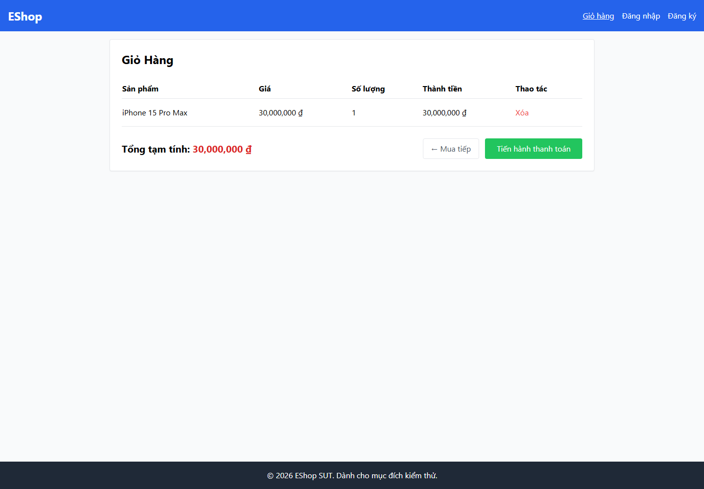

# BUG-IA-01-CART-001: Cột Đơn giá trong Cart bị ghi thành Giá

## Found by Test Case
GUI-022

## Requirement liên quan
FR-07, IA-01

## Severity / Priority
Trivial / P3

## Environment
**Browser**: Google Chrome 157.0.8103.50
**OS**: Windows
**URL**: http://localhost:5173/cart

## Steps to reproduce
1. Thêm sản phẩm vào giỏ và mở Cart.
2. Đọc năm tiêu đề cột.

## Expected result
Các cột là Sản phẩm, Đơn giá, Số lượng, Thành tiền, Thao tác.

## Actual result
Cột thứ hai hiển thị Giá thay vì Đơn giá.

## Evidence

## GitHub Issue
https://github.com/thu2005/CSC13003_eshop/issues/44
