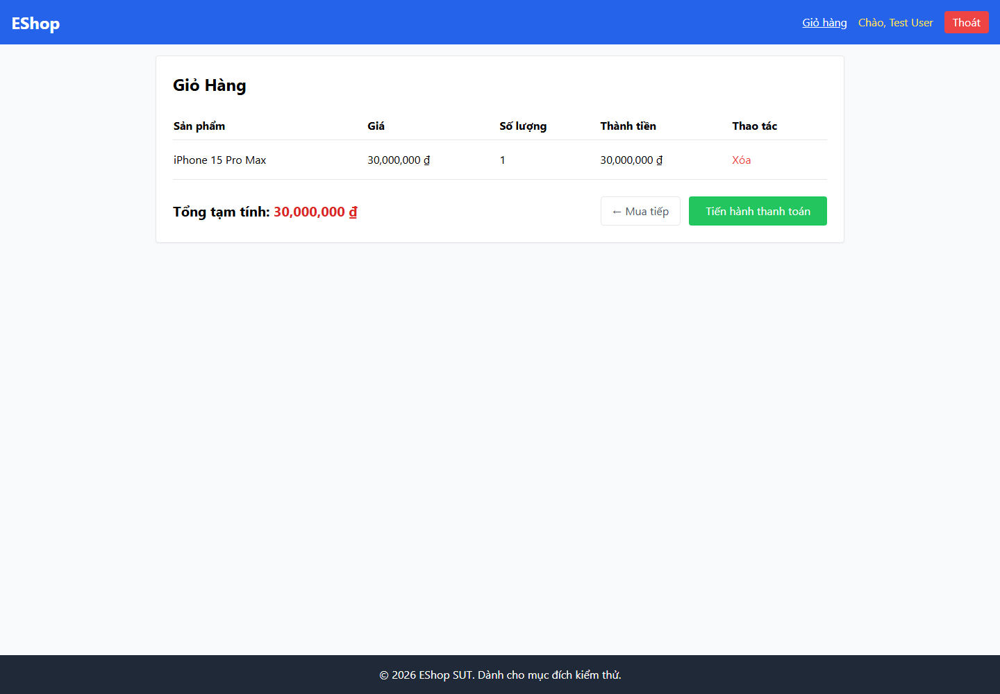

# BUG-IA-01-CART-002: Các điều khiển Cart không đạt touch target tối thiểu

## Found by Test Case
GUI-061

## Requirement liên quan
IA-01

## Severity / Priority
Minor / P2

## Environment
**Browser**: Google Chrome 157.0.8103.50
**OS**: Windows
**URL**: http://localhost:5173/cart

## Steps to reproduce
1. Mở Cart có sản phẩm ở viewport mobile.
2. Đo vùng tương tác của Xóa và Tiến hành thanh toán.
3. Kiểm tra sự hiện diện của −/+.

## Expected result
Các control chính có vùng chạm tối thiểu 44×44 px, không chồng lấn.

## Actual result
Xóa chỉ khoảng 27×24 px, Checkout cao 42 px và không có nút −/+.

## Evidence

## GitHub Issue
TODO — tạo sau khi sinh viên xác nhận title/labels và cho phép push evidence.
