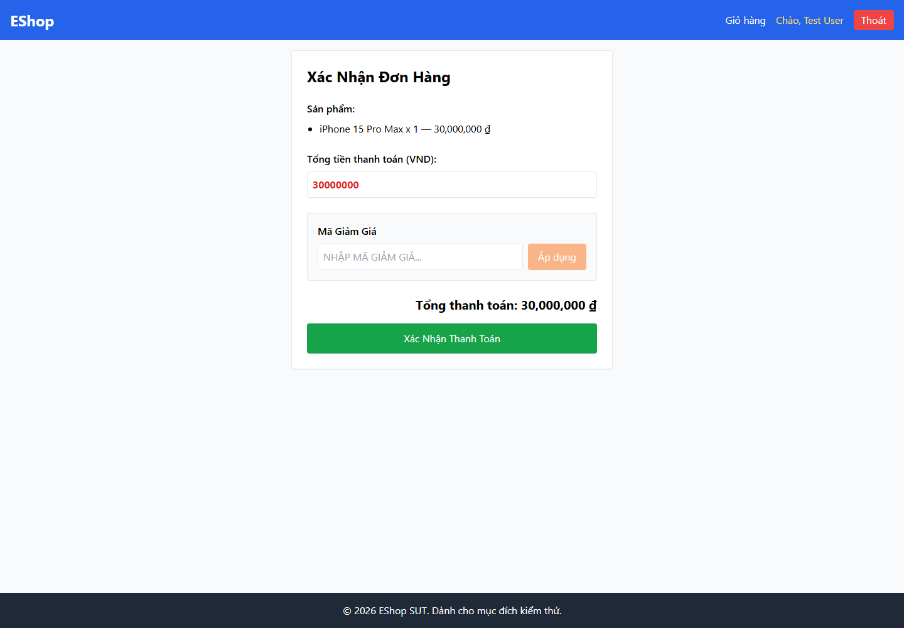

# BUG-IA-01-CROSS-002: Màu action sai chuẩn và contrast chữ trắng không đạt

## Found by Test Case
GUI-056, GUI-058

## Requirement liên quan
FR-21, IA-01

## Severity / Priority
Minor / P2

## Environment
**Browser**: Google Chrome 157.0.8103.50
**OS**: Windows
**URL**: http://localhost:5173/product/1, http://localhost:5173/cart, http://localhost:5173/checkout

## Steps to reproduce
1. Mở ba màn hình trong scope.
2. Quan sát màu các nút action chính.
3. Đo contrast chữ trắng trên nút Áp dụng và Xác Nhận Thanh Toán.

## Expected result
Action tích cực dùng xanh dương; text/button đủ contrast 4.5:1 cho chữ thường.

## Actual result
Action dùng xanh lá/cam; contrast Áp dụng là 2.80:1 và Xác Nhận Thanh Toán là 3.30:1.

## Evidence

## GitHub Issue
TODO — tạo sau khi sinh viên xác nhận title/labels và cho phép push evidence.
