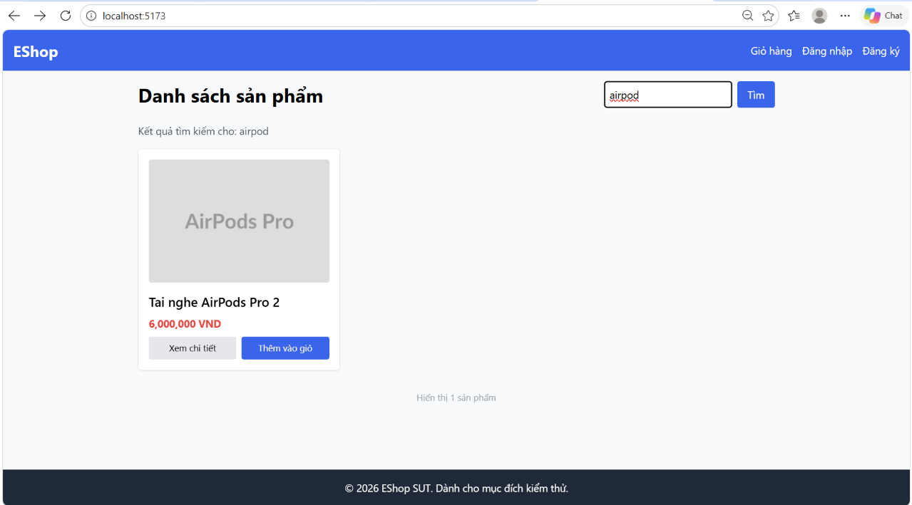
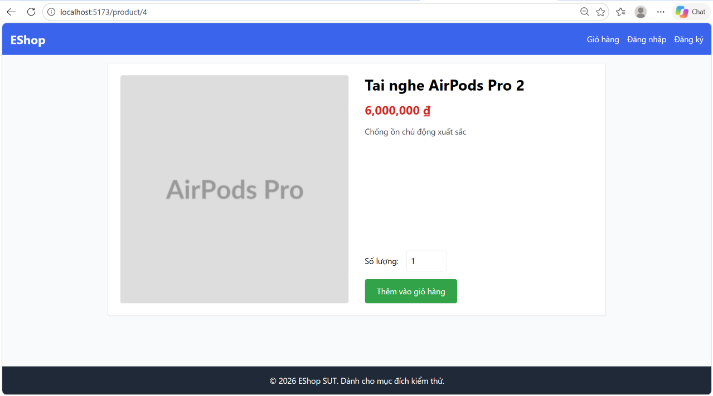

# BUG-IA-01-PRODUCT-001: Ảnh sản phẩm chỉ là placeholder chữ

## Found by Test Case

Usability finding U-05 (dedicated retest)

## Requirement liên quan

FR-05, FR-06, IA-01

## Severity / Priority

Major / P1

## Environment

**Browser**: Microsoft Edge  
**OS**: Windows  
**URL**: http://localhost:5173/ và http://localhost:5173/product/4

## Steps to reproduce

1. Mở trang danh sách sản phẩm và tìm `airpod`.
2. Quan sát ảnh của sản phẩm AirPods Pro 2.
3. Mở trang chi tiết của sản phẩm và quan sát ảnh lớn.

## Expected result

Theo FR-05 và FR-06, trang danh sách và trang chi tiết hiển thị ảnh mô tả đúng
sản phẩm, giúp người dùng nhận biết sản phẩm trực quan.

## Actual result

Cả hai trang chỉ hiển thị một khung màu xám có chữ “AirPods Pro”, không có ảnh
sản phẩm thực tế. Vấn đề cũng được 5/7 participant nhắc đến trong usability
evaluation và làm giảm mức độ tin tưởng vào EShop.

## Evidence

## GitHub Issue

https://github.com/thu2005/CSC13003_eshop/issues/64
