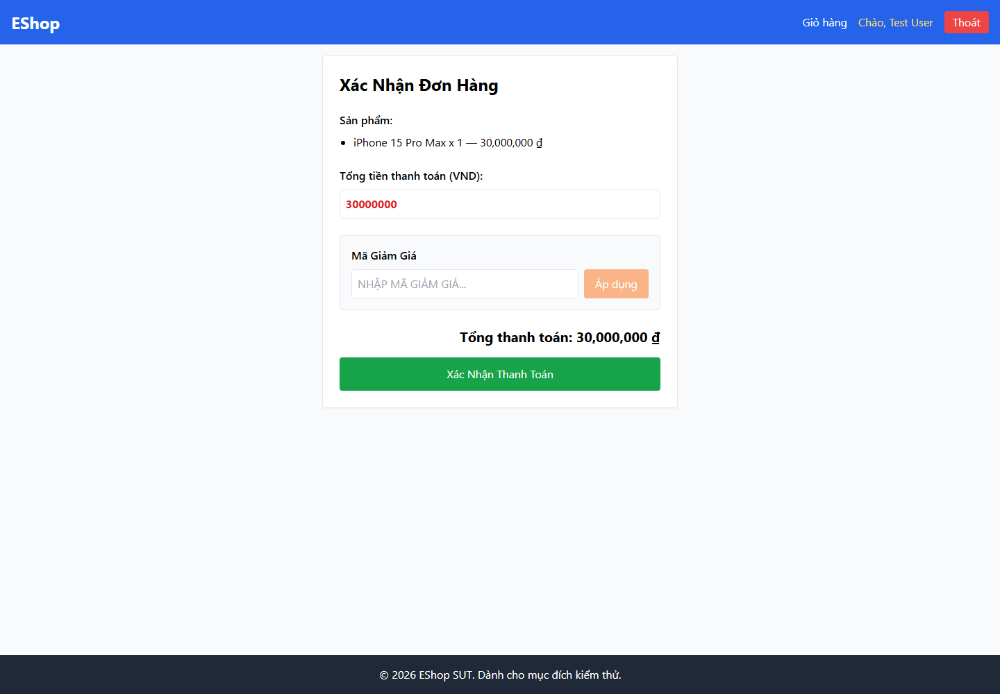

# BUG-IA-02-CHECKOUT-001: Tổng tiền Checkout cho phép người dùng chỉnh sửa

## Found by Test Case
GUI-042

## Requirement liên quan
FR-08, IA-02

## Severity / Priority
Major / P1

## Environment
**Browser**: Google Chrome 157.0.8103.50
**OS**: Windows
**URL**: http://localhost:5173/checkout

## Steps to reproduce
1. Đăng nhập, thêm sản phẩm và mở Checkout.
2. Focus ô Tổng tiền thanh toán.
3. Nhập một giá trị khác.

## Expected result
Tổng tiền được tính tự động và chỉ đọc.

## Actual result
Tổng tiền là input type=number không có readonly/disabled và sửa trực tiếp được.

## Evidence

## GitHub Issue
https://github.com/thu2005/CSC13003_eshop/issues/49
