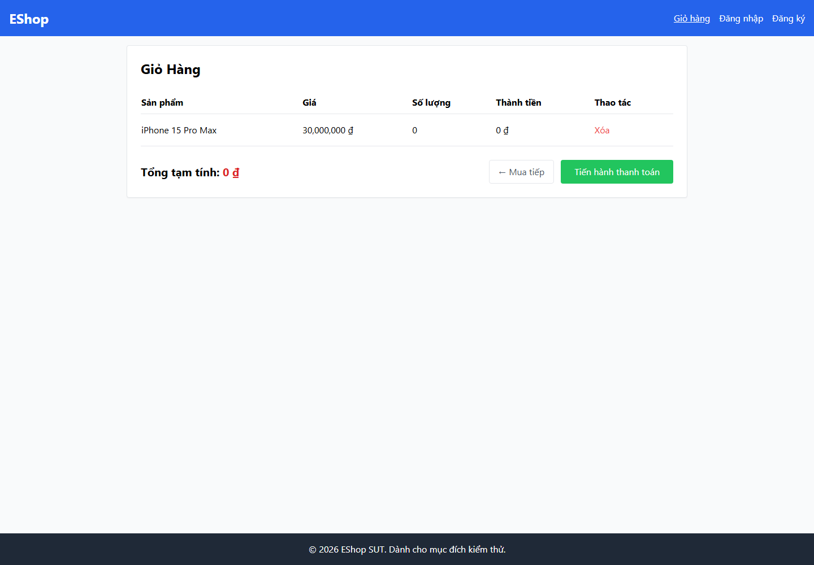

# BUG-IA-02-PRODUCT-001: Ô số lượng chấp nhận số âm, 0, số thập phân và giá trị rỗng

## Found by Test Case
GUI-007, GUI-008

## Requirement liên quan
FR-06, IA-02

## Severity / Priority
Major / P1

## Environment
**Browser**: Google Chrome 157.0.8103.50
**OS**: Windows
**URL**: http://localhost:5173/product/1

## Steps to reproduce
1. Mở chi tiết sản phẩm iPhone 15 Pro Max.
2. Lần lượt nhập `-1`, `0`, `1.5` và để rỗng trong ô Số lượng.
3. Bấm Thêm vào giỏ hàng và mở Giỏ hàng.

## Expected result
Hệ thống từ chối mọi giá trị không phải số nguyên dương từ 1 trở lên và hiển thị phản hồi rõ ràng.

## Actual result
Sản phẩm vẫn được thêm với số lượng âm hoặc 0; số thập phân bị ép thành số
nguyên và giá trị rỗng tạo quantity không hợp lệ. Trong session P06, quantity
`-1` làm thành tiền hiển thị `-6.000.000 ₫`; participant phải xóa sản phẩm để
tiếp tục.

## Evidence

Usability evidence bổ sung: [Session P06, mốc 01:16–01:43](https://www.youtube.com/watch?v=b1zkPGr5dKc).

## GitHub Issue
https://github.com/thu2005/CSC13003_eshop/issues/50
