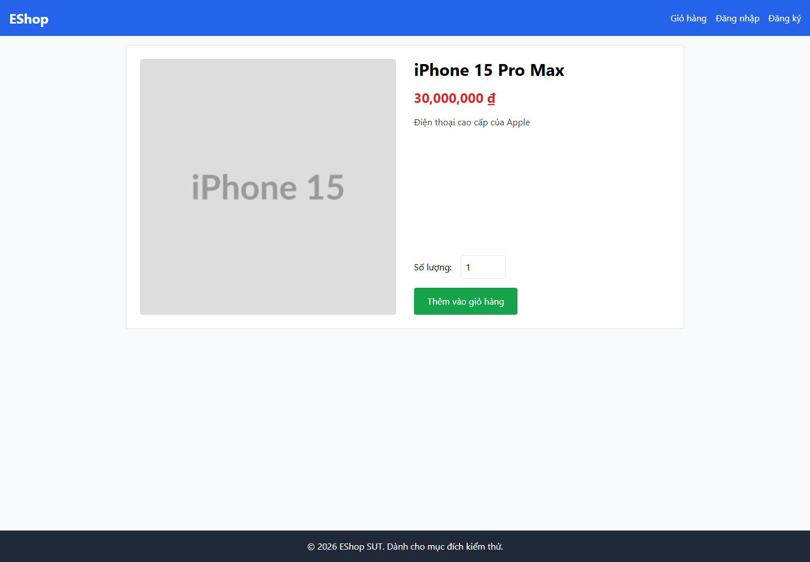

# BUG-IA-03-CROSS-001: Điều khiển Product Detail và Cart không có focus indicator nhìn thấy

## Found by Test Case
GUI-010, GUI-029

## Requirement liên quan
FR-21, IA-03

## Severity / Priority
Minor / P2

## Environment
**Browser**: Google Chrome 157.0.8103.50
**OS**: Windows
**URL**: http://localhost:5173/product/1, http://localhost:5173/cart

## Steps to reproduce
1. Mở Product Detail hoặc Cart có sản phẩm.
2. Dùng Tab để focus ô số lượng, nút Thêm vào giỏ hàng hoặc Xóa.
3. Quan sát trạng thái focus.

## Expected result
Mọi điều khiển tương tác có focus indicator rõ ràng khi dùng bàn phím.

## Actual result
Computed style cho thấy outline-style=none và box-shadow=none; người dùng không nhìn thấy vị trí focus.

## Evidence

## GitHub Issue
TODO — tạo sau khi sinh viên xác nhận title/labels và cho phép push evidence.
