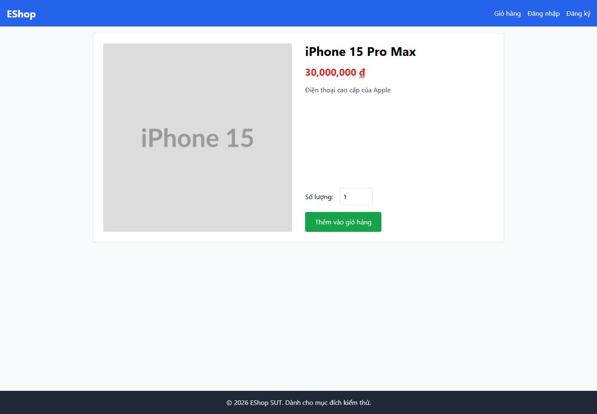

# BUG-IA-03-CROSS-002: Ba trang con không có breadcrumb bắt buộc

## Found by Test Case
GUI-011, GUI-030, GUI-046

## Requirement liên quan
FR-23, IA-03

## Severity / Priority
Minor / P2

## Environment
**Browser**: Google Chrome 157.0.8103.50
**OS**: Windows
**URL**: http://localhost:5173/product/1, http://localhost:5173/cart, http://localhost:5173/checkout

## Steps to reproduce
1. Mở lần lượt Product Detail, Shopping Cart và Checkout.
2. Quan sát khu vực đầu nội dung của từng trang.

## Expected result
Mỗi trang con có breadcrumb thể hiện vị trí hiện tại và đường quay lại hợp lý.

## Actual result
Không trang nào hiển thị breadcrumb.

## Evidence

## GitHub Issue
https://github.com/thu2005/CSC13003_eshop/issues/53
