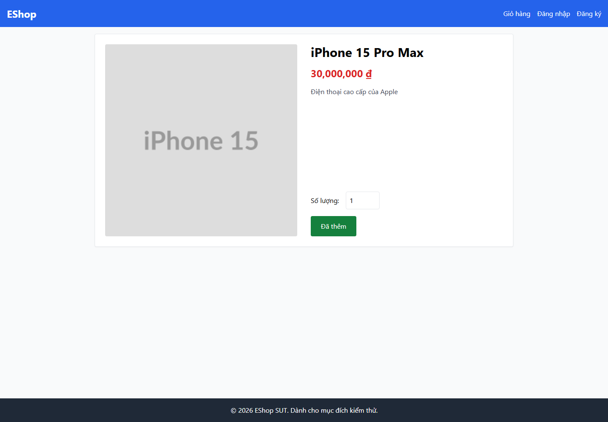

# BUG-IA-03-CROSS-003: Link Giỏ hàng không hiển thị badge số lượng

## Found by Test Case
GUI-014, GUI-037

## Requirement liên quan
FR-23, IA-03, IA-04

## Severity / Priority
Minor / P2

## Environment
**Browser**: Google Chrome 157.0.8103.50
**OS**: Windows
**URL**: http://localhost:5173/product/1, http://localhost:5173/cart

## Steps to reproduce
1. Thêm một sản phẩm vào giỏ.
2. Quan sát link Giỏ hàng trên navbar.
3. Xóa sản phẩm và quan sát lại navbar.

## Expected result
Badge luôn hiển thị đúng tổng quantity và đồng bộ sau mọi thay đổi.

## Actual result
Link chỉ có chữ Giỏ hàng, không có badge ở cả trạng thái có sản phẩm và giỏ trống.

## Evidence

## GitHub Issue
https://github.com/thu2005/CSC13003_eshop/issues/54
