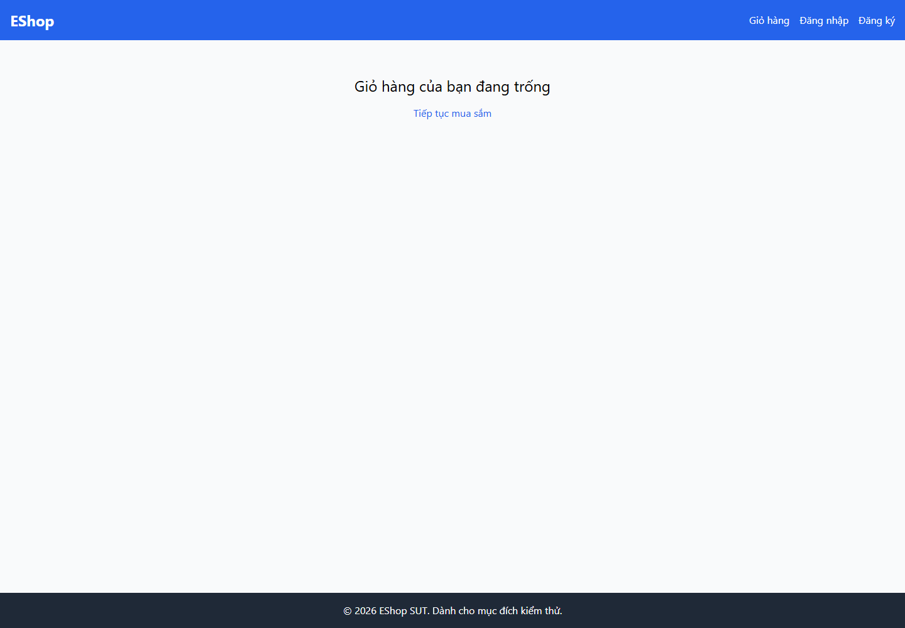

# BUG-IA-04-CART-001: Empty state của Cart không có icon hoặc hình minh họa

## Found by Test Case
GUI-034

## Requirement liên quan
FR-07, FR-24, IA-04

## Severity / Priority
Minor / P2

## Environment
**Browser**: Google Chrome 157.0.8103.50
**OS**: Windows
**URL**: http://localhost:5173/cart

## Steps to reproduce
1. Đảm bảo giỏ hàng trống.
2. Mở Cart và quan sát empty state.

## Expected result
Empty state có icon/hình minh họa, message thân thiện và hành động tiếp tục mua sắm.

## Actual result
Có message và action nhưng không có icon hoặc hình minh họa.

## Evidence

## GitHub Issue
TODO — tạo sau khi sinh viên xác nhận title/labels và cho phép push evidence.
