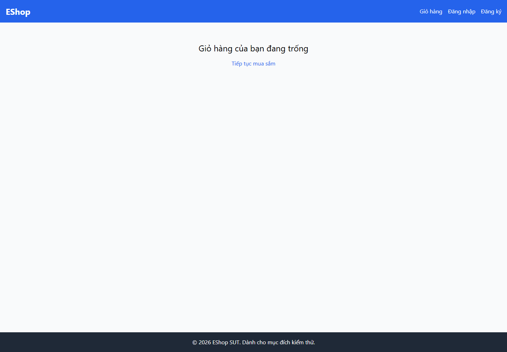

# BUG-IA-04-CART-002: Xóa sản phẩm khỏi Cart không yêu cầu xác nhận

## Found by Test Case
GUI-035

## Requirement liên quan
FR-07, FR-24, IA-04

## Severity / Priority
Major / P1

## Environment
**Browser**: Google Chrome 157.0.8103.50
**OS**: Windows
**URL**: http://localhost:5173/cart

## Steps to reproduce
1. Thêm sản phẩm vào giỏ và mở Cart.
2. Bấm Xóa trên dòng sản phẩm.

## Expected result
Dialog xác nhận xuất hiện trước khi xóa.

## Actual result
Sản phẩm bị xóa ngay mà không có dialog xác nhận.

## Evidence

## GitHub Issue
https://github.com/thu2005/CSC13003_eshop/issues/57
