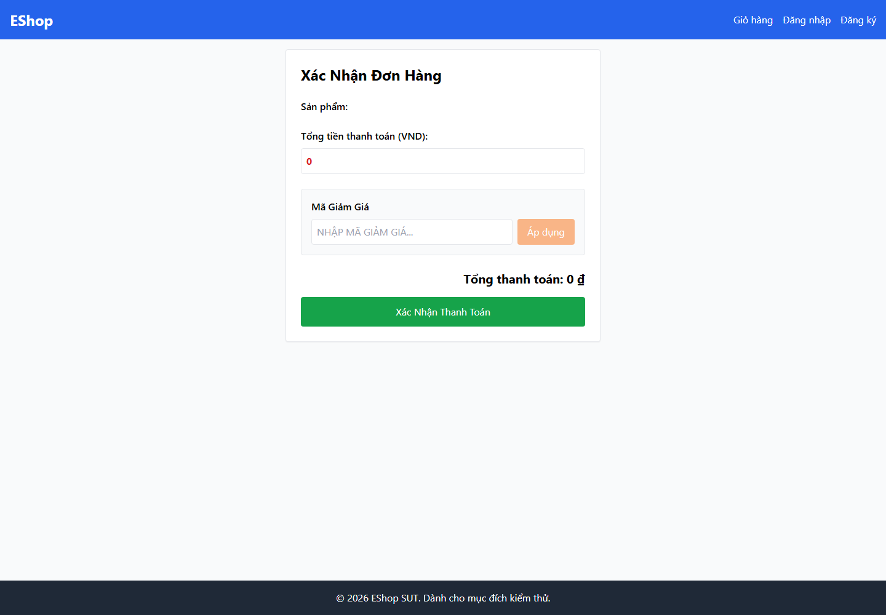

# BUG-IA-04-CHECKOUT-001: Checkout không bảo vệ route và không xử lý session hết hạn

## Found by Test Case
GUI-049, GUI-064

## Requirement liên quan
FR-08, IA-03, IA-04

## Severity / Priority
Major / P1

## Environment
**Browser**: Google Chrome 157.0.8103.50
**OS**: Windows
**URL**: http://localhost:5173/checkout

## Steps to reproduce
1. Khi chưa đăng nhập, mở trực tiếp /checkout.
2. Ở một lượt đã đăng nhập và có giỏ, thay token bằng token hết hạn rồi reload Checkout.
3. Quan sát route, thông báo và giỏ hàng.

## Expected result
Người chưa đăng nhập được giải thích và chuyển Login; session hết hạn có thông báo rõ và không làm mất giỏ âm thầm.

## Actual result
Form Checkout vẫn hiển thị khi chưa đăng nhập; sau token hết hạn không có thông báo và giỏ biến mất khi reload.

## Evidence

## GitHub Issue
https://github.com/thu2005/CSC13003_eshop/issues/59
