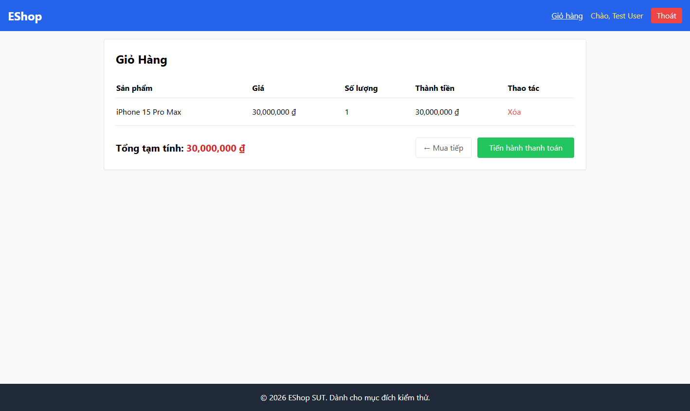

# BUG-IA-04-CHECKOUT-003: Checkout thành công không xóa giỏ hàng

## Found by Test Case
GUI-054

## Requirement liên quan
FR-08, IA-04

## Severity / Priority
Major / P1

## Environment
**Browser**: Google Chrome 157.0.8103.50
**OS**: Windows
**URL**: http://localhost:5173/checkout

## Steps to reproduce
1. Đăng nhập, thêm một sản phẩm và hoàn tất Checkout.
2. Từ trang thành công quay về trang chủ.
3. Mở Giỏ hàng.

## Expected result
Giỏ hàng trống sau checkout thành công.

## Actual result
Sản phẩm và tổng tiền cũ vẫn còn nguyên trong Cart.

## Evidence

## GitHub Issue
https://github.com/thu2005/CSC13003_eshop/issues/61
