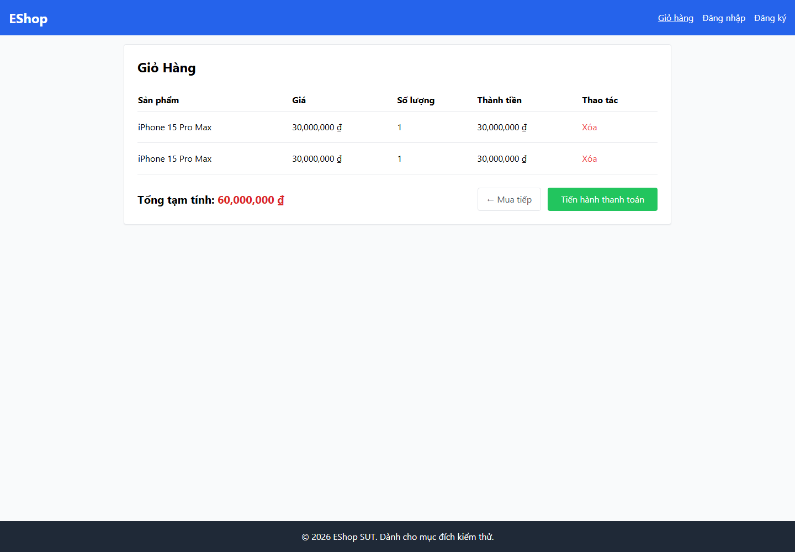

# BUG-IA-04-PRODUCT-001: Thêm vào giỏ bỏ qua click đầu và tạo dòng trùng khi thêm lại

## Found by Test Case
GUI-017, GUI-018

## Requirement liên quan
FR-06, FR-07, FR-24

## Severity / Priority
Major / P1

## Environment
**Browser**: Google Chrome 157.0.8103.50
**OS**: Windows
**URL**: http://localhost:5173/product/1

## Steps to reproduce
1. Mở Product Detail với quantity 1.
2. Bấm Thêm vào giỏ hàng một lần và kiểm tra phản hồi/giỏ.
3. Bấm đủ lần để thêm cùng sản phẩm hai lần rồi mở Cart.

## Expected result
Click đầu thêm ngay và có phản hồi; lần thêm sau tăng quantity trên cùng dòng.

## Actual result
Click đầu không làm gì; hai lần thêm thành công tạo hai dòng riêng, mỗi dòng quantity 1.

## Evidence

## GitHub Issue
TODO — tạo sau khi sinh viên xác nhận title/labels và cho phép push evidence.
