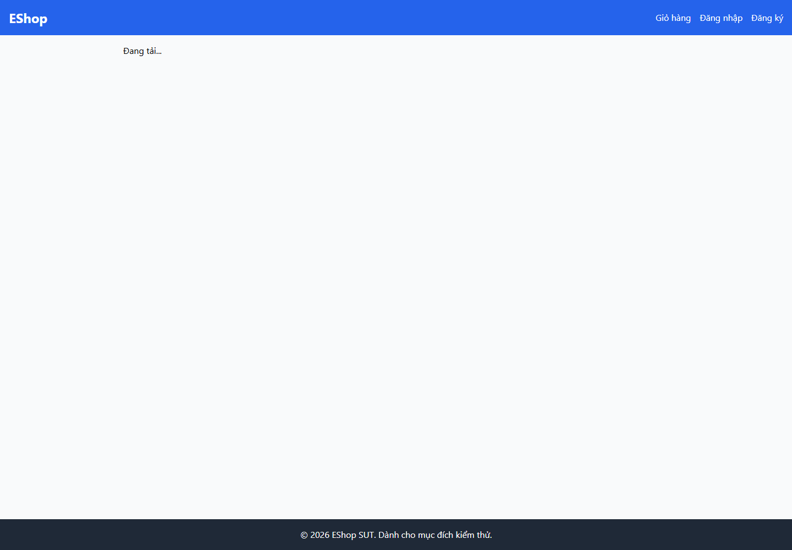

# BUG-IA-04-PRODUCT-002: Product Detail thiếu trạng thái phục hồi cho 404 và lỗi mạng

## Found by Test Case
GUI-019, GUI-020

## Requirement liên quan
FR-06, IA-04

## Severity / Priority
Minor / P2

## Environment
**Browser**: Google Chrome 157.0.8103.50
**OS**: Windows
**URL**: http://localhost:5173/product/999

## Steps to reproduce
1. Mở URL product ID không tồn tại.
2. Lặp lại với request API sản phẩm bị chặn.
3. Quan sát thông báo và hành động phục hồi.

## Expected result
404 có not-found state thân thiện và đường quay lại; lỗi mạng có thông báo cùng nút thử lại.

## Actual result
404 hiển thị text nội bộ không có đường quay lại; lỗi mạng treo vĩnh viễn ở Đang tải.

## Evidence

## GitHub Issue
TODO — tạo sau khi sinh viên xác nhận title/labels và cho phép push evidence.
